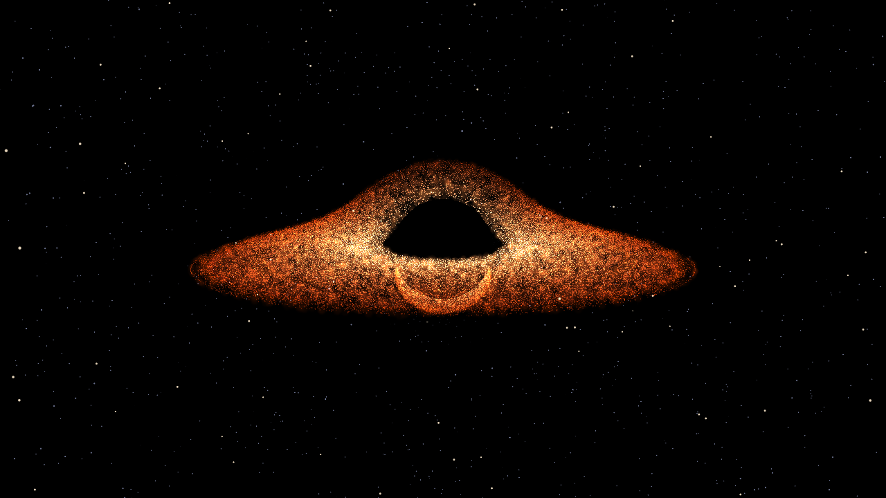
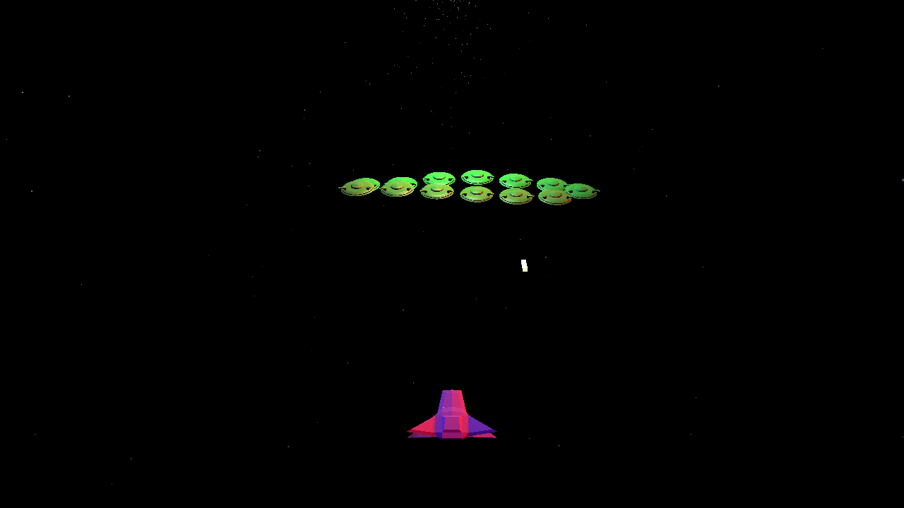

<div align="center">

# Modular Engine

**A modular 3D graphics engine built with modern C++**

[](LICENSE)
[](https://isocpp.org/)
[](https://cmake.org/)
[](https://www.opengl.org/)

Built on a robust **Entity-Component-System (ECS)** architecture with flexible rendering capabilities using OpenGL and SDL3.

[Features](#features) · [Architecture](#architecture) · [Installation](#installation) · [Usage](#usage) · [Contributing](#contributing)

<br/>



<sub>The black hole example: 86k particles on Keplerian orbits, bent by a point-mass gravitational lens.</sub>

</div>

---

## Table of Contents

- [Features](#features)
- [Architecture](#architecture)
- [Prerequisites](#prerequisites)
- [Installation](#installation)
- [Project Structure](#project-structure)
- [Building](#building)
- [Usage](#usage)
- [Technologies](#technologies)
- [Contributing](#contributing)
- [License](#license)

---

<a id="features"></a>

## Features

| Category                   | Description                                                                    |
| -------------------------- | ------------------------------------------------------------------------------ |
| **ECS Architecture**       | Sparse-set component pools: O(1) lookups, packed iteration, stable component addresses |
| **App Base Class**         | Simple `App` interface with `setup()` and `update()` for clean game logic      |
| **Generic Components**     | Any plain struct works as a component — no base class required                 |
| **OpenGL Rendering**       | Modern graphics API integration with full shader support                       |
| **Instanced Rendering**    | Models sharing mesh and material are drawn in one call, in the main and shadow passes |
| **Frustum Culling**        | Models outside the camera are skipped using their mesh's bounding sphere       |
| **PBR Material System**    | Per-submesh materials with diffuse, specular, normal, and emission maps        |
| **Solid Color Fallback**   | Centralized solid color texture generation and caching for simple rendering    |
| **Resource Caching**       | Automatic texture caching with handle-based resource management                |
| **Shadow Mapping**         | Cascaded sun shadows that follow the camera (3 cascades out to 80 units) and cube-map shadows for up to 4 point/spot lights (`Light::castShadows`), re-rendered only when something within the light's range moves; hardware-filtered PCF |
| **Asset Loading**          | OBJ (Tiny_Obj) and glTF/GLB (tinygltf) with named parts, shared materials, background loading (`preloadModel`) and a binary mesh cache (`bin/cache/meshes`) |
| **Texture Streaming**      | Textures converted once to GPU-compressed BC1/BC3 (BC5 for normal maps) with mipmaps, cached in `bin/cache/textures`, and uploaded over several frames, smallest mip first |
| **Normal Maps**            | Tangent-space normal maps on OBJ and glTF models; tangents read from glTF or generated from UVs |
| **Skybox**                 | Equirectangular panorama (png/jpg/hdr) behind the scene: `withSkybox(path, intensity, rotation)`, plus the scene's fog and ambient light; saved in scene files, editable in the Properties panel |
| **HDR & Bloom**            | Lighting rendered in HDR, highlights rolled off instead of clipped, and bloom around emission and strong highlights (`F10`) |
| **glTF Materials**         | Base color tint, alpha modes (opaque, mask, blend), double-sided and unlit (`KHR_materials_unlit`) materials |
| **Camera System**          | Flexible camera control with quaternion-based rotations                        |
| **Camera Follow**          | A `CameraRig` component (or `camera.follow(entity, options)`) trails an entity from behind, with offset, look-ahead, smoothing and optional mouse / right-stick orbit; moved after physics so it does not jitter |
| **Tags**                   | Labels on entities (`addTag`, `engine.findTagged`), saved in scenes and prefabs and edited in the Properties panel |
| **Tweens & Coroutines**    | Animate position, rotation, scale or color (or a number) with easing curves in C++ and Lua; Lua also has `wait` inside coroutines (`engine.run`, `self:run`), all on game time |
| **Input System**           | Keyboard, mouse and gamepads (SDL3), named actions and axes with bindings in code or a JSON file, gamepad rumble, text entry, mouse capture for mouse-look |
| **Lighting System**        | Directional, point, and spotlight types with intensity and cutoff controls; gamma-correct by default |
| **Transparency & Sorting** | Back-to-front sorting for transparent objects with opacity support             |
| **Audio**                  | 3D positioned sounds following the camera, one-shots, streamed music and volume buses (miniaudio); effects pause with `F7` |
| **Game UI**                | Menus and HUD as RmlUi documents (HTML/CSS-like RML/RCSS) with data binding, transitions and animations; `F9` opens its debugger |
| **Pause Menu**             | A ready-made menu (Resume, Options, Quit) on `Escape`, a document of your project written on the generic `pause_menu` data model: `engine.ui().pauseMenu(true)`, or `ui.pauseMenu(true)` in Lua; the player's options are the `settings` service |
| **Menus & Screens**        | Any RmlUi document as a menu (`ui.menu(path, options)` / `engine.ui().menu(path, options)`): a stack where only the top one takes input, options for pausing, the cursor and `Escape`, buttons that reach the game with `action('name')`; the pause menu is one of them. A loading screen for slow scene loads (`ui.loadingScreen()`). New projects ship a main menu, Options, game over and loading screens |
| **Saved Data**             | A per-game key-value store for progress and settings in the user's preferences folder, written atomically: `engine.saveData()`, or `save.get` / `save.set` in Lua |
| **Lua Scripting**          | Entity and game scripts with hot reload, the engine's API, and C++ functions handed to them (Lua 5.4, sol2) |
| **Project Launcher**       | Creates Lua, C++ or C++ + Lua projects, builds, plays and exports them, opens them in VS Code |
| **Skeletal Animation**     | glTF skins and clips (linear, step, cubic spline), crossfades, rigid parts following their nodes, animated shadows; state machines (JSON: states, blends, parameters, transitions) |
| **Physics**                | Jolt: static, dynamic and kinematic bodies (box, sphere, capsule, convex hull, mesh), a character controller, impulses, raycasts and contact events, collision layers with a matrix |
| **Navigation**             | A walkable grid built from the physics world and A* paths around obstacles, smoothed (`engine.navigation().findPath`, `nav.path` in Lua), drawn by the editor's "Show navigation" |
| **Play / Stop**            | Freeze the game, edit, Play from there and Stop back to the saved state, game components included (`Ctrl+P`) |
| **Hierarchy & Prefabs**    | Parent/child entities (`setParent`, `withParent`) and prefabs (`savePrefab`, `instantiate`, nested prefabs), saved in scenes and edited in the editor |
| **Linked Prefabs**         | Instances remember their prefab file and follow it when it changes (in the editor or on disk), keeping what they changed themselves; Apply, Revert and Unpack in the Properties panel (undoing an Apply puts the prefab file back too) |
| **Asset Browser**          | The editor's Assets panel lists `assets/` by kind with a search box: drag models and prefabs into the view, scripts and sounds onto entities, double-click to open |
| **Multi-select**           | Ctrl/Cmd+click, Shift+click ranges and a box in the view select several entities; the gizmo, Properties, duplicate, copy, paste and delete work on all of them |
| **Collisions**             | Axis-aligned boxes (`withCollision`, or fitted to the model with `withModelCollision`), queried by component pair (`forEachCollision<Bullet, Enemy>`) and by ray (`raycast<Enemy>`) |
| **Particle System**        | Advanced emitter with cone/sphere/box/ring shapes, attraction, and recycling   |
| **Gravitational Lensing**  | `GravityLens` component bends particles behind it into primary and secondary images |
| **Performance Overlay**    | `F5` shows FPS, frame time, work time before the buffer swap and the worst frame |
| **VSync & Pause**          | `F6` toggles vsync; `F7` pauses the simulation while the camera keeps moving |
| **Scenes**                 | Save the running scene to JSON and load or switch scenes at runtime (`Engine::saveScene`/`loadScene`, Settings panel) |
| **Screenshots**            | `F12` (or `--screenshot`) saves the current frame as a BMP                     |
| **UI Integration**         | ImGui-based editor (`F2`) with click-to-select in the scene, move/rotate/scale gizmos (ImGuizmo), material inspector, light tweaks, entity hierarchy and a settings panel |
| **Behavior Tests**         | `tools/run_tests.py` runs Lua and C++ tests of the game API (entities, tags, timers, coroutines, tweens, camera, physics, navigation, saves, UI, input) in CI, headless under xvfb |
| **Regression Tests**       | `tools/regression.py` compares screenshots and frame times of every example and scene with references, on repeatable `--deterministic` runs |
| **Settings Panel**         | Every toggle with its key (`F1`–`F10`), time scale, camera FOV/speed, audio volumes, screenshots and render stats (draw calls, culled meshes, particles) |
| **Scene Management**       | Entity lifecycle management and component composition                          |

---

<a id="architecture"></a>

## Architecture

The engine is built on the **Entity-Component-System (ECS)** pattern, which separates data (components) from logic (systems) for maximum flexibility and performance.

```
┌────────────────────────────────────────────────────────┐
│                        Engine                          │
│  ┌─────────────┐  ┌──────────────┐  ┌───────────────┐  │
│  │  ECS Core   │  │   Renderer   │  │  Input/Window │  │
│  │  (Entities, │  │  (OpenGL,    │  │  (SDL3)       │  │
│  │  Components,│  │  Shaders,    │  │               │  │
│  │  Systems)   │  │  Shadows)    │  │               │  │
│  └─────────────┘  └──────────────┘  └───────────────┘  │
│  ┌─────────────┐  ┌──────────────┐  ┌───────────────┐  │
│  │  Resources  │  │  Scenes      │  │  Editor UI    │  │
│  │  (OBJ/glTF, │  │  (Lifecycle, │  │  (ImGui:      │  │
│  │  mesh and   │  │  JSON save/  │  │  inspector,   │  │
│  │  texture    │  │  load and    │  │  hierarchy,   │  │
│  │  caches)    │  │  switching)  │  │  settings)    │  │
│  └─────────────┘  └──────────────┘  └───────────────┘  │
│  ┌─────────────┐  ┌──────────────┐                     │
│  │  Audio      │  │  Game UI     │                     │
│  │  (miniaudio,│  │  (RmlUi:     │                     │
│  │  3D sound)  │  │  menus, HUD) │                     │
│  └─────────────┘  └──────────────┘                     │
└────────────────────────────────────────────────────────┘
```

### Directory Organization

| Directory   | Purpose                                             |
| ----------- | --------------------------------------------------- |
| `src/`      | Source and header files organized by engine module  |
| `external/` | Third-party dependencies and libraries              |
| `assets/`   | Game assets — models, shaders, sounds, scenes and game UI documents |

---

<a id="prerequisites"></a>

## Prerequisites

- **CMake** 3.14+
- **C++ compiler** with modern standard support (C++17 or later recommended)
- **OpenGL** compatible graphics driver
- **Git**

---

<a id="installation"></a>

## Installation

**Clone the repository:**

```bash
git clone https://github.com/phmuni/modular-engine.git
cd modular-engine
```

Bundled dependencies (ImGui, glad, stb_image, Tiny_Obj, tinygltf) live in `external/`. SDL3, GLM, nlohmann/json, miniaudio, RmlUi and FreeType are fetched automatically by CPM at configure time (internet required on first build).

---

<a id="project-structure"></a>

## Project Structure

```
modular-engine/
├── src/                        # Source and header files
│   ├── components/             # ECS component definitions and their JSON form for scene files
│   ├── foundation/             # Core engine, ECS, config and file caches
│   ├── game/                   # Example apps: Space Aliens, Black Hole, Stress, a model viewer and a scene browser
│   ├── rendering/              # Renderer and resources: meshes, materials, texture conversion and streaming
│   └── systems/                # ECS systems: rendering, lights, audio, game UI, scenes, editor UI...
├── cmake/                      # CPM package manager script
├── external/                   # Bundled third-party dependencies
├── assets/                     # Models, shaders, sounds, scenes (JSON) and game UI (RML/RCSS)
├── tests/                      # Behavior tests: Lua scripts (lua/), C++ cases (cpp/), fixtures; tests/regression/ is local
├── tools/                      # Python tools: regression.py, run_tests.py, packaging, API checks
├── bin/                        # Compiled binaries
├── build/                      # CMake build output
└── CMakeLists.txt              # Build configuration
```

---

<a id="building"></a>

## Building

**1. Generate build files:**

```bash
cmake -S . -B build                              # Release (default)
cmake -S . -B build -DCMAKE_BUILD_TYPE=Debug     # Debug, without optimizations
```

**2. Compile the engine:**

```bash
cmake --build build
```

**3. Run:**

```bash
./bin/engine              # Space Aliens
./bin/engine blackhole    # Black hole
./bin/engine stress       # 2500 lit, shadowed boxes (for benchmarking)
./bin/engine view path/to/model.glb   # any OBJ or glTF/GLB, framed automatically
./bin/engine scene [file.json]        # scene files in assets/scenes; [ and ] switch between them
```

In Space Aliens a chase camera follows the ship: `W` `A` `S` `D` or the arrows fly up, down and sideways, `Space` fires, and four waves of aliens fly in from the far end into formations, shoot at the ship and dive at it.

In the black hole example and the model viewer the camera orbits on its own: `←` `→` orbit, `↑` `↓` change the elevation and `W` `S` zoom.

**Controls (all examples):**

| Key | Action |
| --- | --- |
| `F1` | Wireframe |
| `F2` | Debug UI (scene explorer, properties, settings), docked at the sides so the middle of the view stays free; it gives the cursor back, and the cursor lock returns when it closes |
| `F3` | Shadows |
| `F4` | Free camera up/down: with the free camera on, `Space` and `Shift` also move it vertically |
| `F5` | Performance overlay |
| `F6` | VSync |
| `F7` | Pause the simulation |
| `F8` | Gamma-correct lighting |
| `F9` | Game UI (RmlUi) debugger |
| `F10` | Bloom |
| `F12` | Screenshot (`bin/screenshot.bmp`) |
| `Escape` | The pause menu, in games that enable it |
| `Right Alt` / `Right Option` | Cursor lock |
| Hold the right mouse button in the view | Editor camera, while editing (**Edit**): the mouse looks, `W` `A` `S` `D` fly (`E` or `Space` up, `Q` or `Ctrl` down, `Shift` faster, the wheel changes the speed). The game gets none of it, and `W` `E` `R` `T` keep their gizmo meaning off the button. With the free camera on (Settings) it works in any mode |
| `W` `A` `S` `D`, `Space`, `Shift` + mouse | Free camera with the cursor locked (`Right Alt`), when it is on in Settings or while editing |
| `Tab` | Editor: hide or show every panel; the editor stays on (selecting, the gizmo, the camera). Settings > Interface has the UI scale (75 % to 200 %, automatic from the display by default, kept in `imgui.ini`) |
| Left click in the scene | Editor: select the model under the cursor (empty space clears the selection; debug UI shown, cursor unlocked) |
| `Ctrl` + `P` | Editor: freeze the game to edit the scene, Play from there, Stop to put the scene back (also the bar at the top) |
| `Ctrl` + `Z` / `Ctrl` + `Shift` + `Z` or `Ctrl` + `Y` | Editor: undo / redo the last scene edit (also the Undo and Redo buttons in the bar at the top) |
| `W` / `E` / `R` / `T` | Editor gizmo on the selected entity: move / rotate / scale / resize (cursor unlocked; `Ctrl` snaps; **Resize** puts a handle on each face, and dragging one moves that face alone; **Solid** in the Properties panel stops it where its triangles touch another model's, and it slides along; **Align to surface** makes the move gizmo place it on the surface under the cursor, tilted to its slope) |

To save a frame without a window manager screenshot, pass `--screenshot <file.bmp> [seconds]`; the engine waits that long (3 seconds by default), saves the frame and exits:

```bash
./bin/engine blackhole --screenshot black-hole.bmp 4
```

| Space Aliens | Black Hole |
| --- | --- |
|  |  |

To turn what an example builds into a scene file, pass `--save-scene <file.json> [seconds]`; the engine runs that long (0 by default), saves and exits:

```bash
./bin/engine blackhole --save-scene ../assets/scenes/black_hole.json 0.5
```

### Regression tests

`tools/regression.py` runs every example and scene with `--deterministic` (fixed 1/60 s frames, seeded randomness, scene switches and texture uploads that do not depend on background threads), so a build renders the same pixels every time. It compares a screenshot of each with a reference PNG and a short benchmark with a stored baseline, and fails on changed pixels, warnings in the log, or frames more than 20 % slower:

```bash
python3 tools/regression.py --update   # record references and baselines from a build you trust
python3 tools/regression.py            # after a change: exit code 1 on a regression
python3 tools/regression.py --only aliens --images-only
```

References and baselines describe this machine's GPU, speed and build type, so they live in `tests/regression/` and are not committed; changed screenshots and diff images (changes in red) go to `tests/regression/out/`. Python's standard library is enough.

### Behavior tests

`tests/` holds tests of the game API itself (entity handles, `engine.create`, prefabs, tags, timers, `wait`, tweens, the camera rig, physics, navigation, saved data, UI helpers, text and mouse input). Each one is a start of `bin/engine_tests`, which opens a window, runs the test on fixed 1/60 s frames (`--deterministic`) and exits non-zero when a check fails or the test hangs. Lua tests are scripts in `tests/lua`; C++ tests are `TEST_CASE`s in `tests/cpp` that drive `Engine` through the same facades.

```bash
cmake -B build -DMODULAR_ENGINE_BUILD_TESTS=ON && cmake --build build --target engine_tests
python3 tools/run_tests.py                 # all of them, in parallel (the CPU count, at most 8): exit code 1 if any fails, failures print their output
python3 tools/run_tests.py tags camera     # only tests whose name contains one of these words
python3 tools/run_tests.py -j 1 -v         # one at a time, with the output of passing tests too
./bin/engine_tests ../tests/lua/tags.lua   # one Lua test; ./bin/engine_tests --list names the C++ ones
```

They need a window with OpenGL 4.1, but not a GPU: on Linux without a screen, install `xvfb` and Mesa's software driver (`libgl1-mesa-dri`) and run `xvfb-run -a -s "-screen 0 1280x720x24" python3 tools/run_tests.py`, as CI does. On Windows, CI puts Mesa's `opengl32.dll` and `libgallium_wgl.dll` (llvmpipe, from pal1000/mesa-dist-win) next to `bin/engine_tests.exe` and sets `GALLIUM_DRIVER=llvmpipe`; you can do the same on a machine without a GPU. The engine's systems all start together with the window and the GL context, so there is no logic-only mode; a small window and software rendering keep the whole suite under a few minutes. Tests keep the save data in memory or in a temporary folder, never in the real save folder.

To add a Lua test, create `tests/lua/<name>.lua`; the runner finds it. The global `test` helper reports failures with their line and lets the script go on:

```lua
-- tests/lua/pickups.lua
test.run(function()                      -- engine.run, then test.done() when it returns; it may wait()
  local coin = engine.create("Coin", { model = "sphere", tags = { "pickup" } })
  test.eq(#engine.findTagged("pickup"), 1)
  test.near(coin.position, vec3(0, 0, 0), 0.01)
  tween.to(coin, "position", vec3(0, 3, 0), 1)
  wait(1.1)                              -- game time: 66 fixed frames
  test.near(coin.position.y, 3, 0.001)
end)
```

`test.ok`, `test.eq` (also tables and vec3s), `test.near`, `test.expectError("part of a message")` (for a script error the test provokes on purpose; any other reported script error fails the test), `test.frame()` and `test.done()` are in `tests/lua/test.lua`. A test that never calls `test.done()` fails after 1200 frames. Files it needs go in `tests/fixtures` (paths like `../tests/fixtures/turret.json` work from the executable's folder).

To add a C++ test, add a `TEST_CASE` to a file in `tests/cpp` (the build picks up new files after a CMake re-run). The body runs once at the start and queues later checks with `steps`, since the engine owns the loop:

```cpp
TEST_CASE(coin_spins) {
  GameEntity coin = engine.create("Coin", Desc("sphere").at(0, 1, 0).tags({"pickup"}));
  CHECK_EQ(engine.findTagged("pickup").size(), size_t(1));
  steps.seconds(1.0f, [coin]() { CHECK_NEAR(coin.position(), glm::vec3(0, 1, 0), 0.01f); });
  steps.until([&engine]() { return !engine.isLoadingScene(); }, "the scene to load", 300);
}
```

`CHECK`, `CHECK_EQ` and `CHECK_NEAR` record a failure and go on; `testing::tempDir("name")` gives a temporary folder removed at exit; `Desc` (`tests/cpp/describe.h`) writes an `EntityDesc` in a line. Events can be pushed with `SDL_PushEvent` (see `uiInputTests.cpp`); the engine reads them at the start of the next frame.

### Benchmarking

`--benchmark [seconds]` (10 by default) turns vsync off, skips a 1 s warm-up and logs frame-time statistics before exiting:

```bash
./bin/engine stress --benchmark 8
# [Benchmark] 21040 frames | avg 0.380 ms (2630 FPS) | p50 0.346 | p95 0.400 | p99 1.164 | max 3.526 ms
```

Average frame time on an Apple M5 at 1280×720, 8 s runs:

| Scene | Debug | Release | Release + optimizations |
| --- | ---: | ---: | ---: |
| Space Aliens | 0.50 ms | 0.27 ms | 0.27 ms |
| Black Hole | 16.04 ms | 0.98 ms | 0.78 ms |
| Stress | 24.18 ms | 6.32 ms | 0.38 ms |

The optimizations are instanced drawing for opaque models and shadows, sparse-set component storage, frustum culling, hardware shadow PCF, allocation-free uniform lookups and reused particle buffers.

---

<a id="usage"></a>

## Usage

The engine exposes an `App` base class — override `setup()` and `update()` to implement your game logic. [`examples/`](examples/) contains four examples, a complete game (Space Aliens), a black hole scene, a stress scene for benchmarking and a model viewer, all launched from [`examples/main.cpp`](examples/main.cpp) (`./bin/engine --help` lists them).

### Creating a game

A game is its own project, in one of three kinds:

| Kind | The game's code | Build |
| --- | --- | --- |
| **Lua** | Scripts in `assets/scripts/` | None: the engine's prebuilt runner plays it, and scripts reload when saved |
| **C++** | `src/*.cpp`, against the engine as a library | CMake |
| **C++ + Lua** | Both: C++ hands functions to the scripts | CMake for the C++; scripts reload when saved |

The **launcher** creates, builds and plays them. Build the engine once, then open it:

```bash
cmake -B build && cmake --build build -j
./bin/launcher/launcher
```

**New project** asks for a name, a folder, the kind and what to start from (the example game or an empty project); each project in the list then has **Play** (a C++ project
builds what changed first), **Build**, **VS Code** and **Folder**. From a terminal, the same:

```bash
./bin/launcher/launcher --create ~/Games/Asteroids lua     # or cpp, mixed
python3 tools/new_game.py ~/Games/Asteroids --type lua     # the same, in Python (asks the kind when left out)
./bin/launcher/launcher --create ~/Games/Asteroids lua --empty   # an empty project (new_game.py has --empty too)
```

By default each kind starts as the same small game (walk, jump, push the crates, collect coins: [`templates/`](templates/)),
whose level is a scene file you edit in the game with `F2`. An **empty project** (`--empty`) is the same kind without
the game: a level with a camera, a light, a sky and a floor, a game script or `main.cpp` with the lifecycle functions
stubbed and commented, `project.json`, the input bindings, the Lua types and VS Code settings, and the pause menu's
files (`assets/ui/pauseMenu.rml`, off until the code calls `ui.pauseMenu(true)`). It builds, runs and opens in the
editor. It is made from the example template's files listed in [`templates/empty/keep.txt`](templates/empty/keep.txt)
with `templates/empty/<lua|cpp|mixed>` over them, so the example's other files never end up in it.

A Lua project is `project.json` (its name, start scene, game script and input file, and optionally its collision `layers` and `window`), `assets/`, and `bin/` with the
runner named after the game. A C++ project's `CMakeLists.txt` points at this checkout (`MODULAR_ENGINE_DIR`; left
empty, the engine is downloaded from GitHub) and builds `src/*.cpp` with `modular_engine_add_game(...)`. Either way
`bin/` holds `bin/engine-assets` (the engine's shaders, fonts and basic models) and SDL's library, asset paths are
written relative to `assets/` (`"prefabs/coin.json"`, in C++ and Lua alike; the older `"../assets/..."`, relative to the
executable, works too), and the folder is the whole game, runnable from anywhere. Every game
gets `--screenshot`, `--benchmark`, `--deterministic` and `--save-scene` on its command line.

Setting the `CPM_SOURCE_CACHE` environment variable to a folder shares the dependency downloads (SDL, RmlUi...)
between C++ projects.

**Export** (a button per project, or `./bin/launcher/launcher --export ~/Games/Asteroids ~/Desktop`) makes the game
to give to players: only the program, SDL's library, `engine-assets` and the project's `assets/` (and `project.json`),
without sources, build folders or caches. A C++ project is built in Release first, in its own `build-release/`, so
your Debug `build/` and `bin/` are left alone. On macOS the result is `<Name>.app` (the program and SDL in
`Contents/MacOS`, `assets/` and `project.json` in `Contents`, `engine-assets` in `Contents/Resources`, which is where
SDL says an app's files are); elsewhere a `<Name>/` folder with `bin/` and `assets/`.
The texture and mesh caches normally go in `bin/cache`; inside an `.app` they go to
`~/Library/Application Support/modular-engine/<Name>/cache` instead. The app is signed ad hoc, enough to run on this
Mac; to give it to others it needs your own Apple signing and notarization.

**Without a compiler**: `python3 tools/package_engine.py` builds the launcher and runner in Release and gathers
`dist/modular-engine-<platform>/` (`bin/launcher`, `bin/runner`, `templates`, this README and the LICENSE). Whoever gets
that folder creates, plays and exports Lua projects with its launcher, with no toolchain and no sources. A C++ project
made from it has an empty `MODULAR_ENGINE_DIR`, so it downloads the engine from GitHub when built.

C++ builds need CMake and a compiler. The launcher looks for `cmake` on the `PATH`, then in the usual places (Homebrew,
CMake.app, `C:\Program Files\CMake`), so it also works when opened from the Finder, which does not pass the shell's
`PATH`. If something is missing, it says what to install (macOS: `xcode-select --install` and `brew install cmake`;
Windows: Visual Studio Build Tools with C++ and CMake; Linux: compiler, git and cmake from the package manager). Lua
projects need none of it.

### Lua scripts

An entity's `Script` component names a Lua file (`scripts/coin.lua`, relative to `assets/`) that gives it its behavior.
A game script (`scripts().runGameScript(...)`, or `project.json`'s `script`) runs for the whole game; the shared `game`
table is seen by every script. Saved scripts reload while the game runs, keeping each entity's state, and errors show
on screen with their file and line without stopping the game.

```lua
-- scripts/coin.lua
properties = {                               -- tunable values, see below
  spin = 120,
}
function onStart(self)                       -- once; fields on self are this entity's own state
  self.score = 0
end
function onUpdate(self, dt)                  -- every frame
  local rotation = self.rotation
  rotation.y = rotation.y + self.spin * dt
  self.rotation = rotation
end
function onOverlap(self, other)              -- its Collision box overlaps another; also onContact(self, other, point,
  if other.name == "Player" then             --   normal) for physics bodies, and onReload(self) after an edit
    game.score = game.score + 1
    sound.play("sounds/coin.wav")
    self:destroy()
  end
end
```

A script's `properties` table lists the values worth tuning: numbers, booleans, strings and `vec3`s (a name with
"color" in it gets a color picker). They show in the editor's Properties panel under the entity's Script, with the
script's value as the default, and each entity can override them there (a `reset` button returns one to the default).
Before `onStart` every property is a field of `self` (`self.spin`), with the entity's value if it has one. Editing one
while the game runs updates `self` at once, and so does saving the script with a new default. Overrides are saved in
scene files as `"Script": {"path": "scripts/coin.lua", "properties": {"spin": 200}}`. A property the script stops
declaring disappears from the panel, but its override stays in the file in case the script declares it again. The panel
lists them by name, and reads the file (running its top level once) even while the game is not running.

What scripts can use:

| | |
| --- | --- |
| `vec3(x, y, z)` | `+ - * /`, `:length()`, `:normalized()`, `:dot(v)`, `:cross(v)`, `:distance(v)`, `:lerp(v, t)` |
| Entities (`self`, `other`) | `name`, `position`, `rotation`, `scale`, `forward`, `right`, `transform`, `light`, `valid`, `visible`, `:destroy()`, `:has("RigidBody")` (or a game component's name), `:parent()`, `:setParent(e)`, `:children()`, `:setColor(c)`, `:setEmission(c, strength)`, `:setVisible(b)`, `:setTexture(slot, path)`, `:setShininess(n)`; bodies: `velocity`, `:impulse(v)`, `:force(v)`; characters: `:move(v)`, `:jump(speed)`, `onGround`; `layer` (collision layer, by name); `:play(clip, fade, loop)`, `:clips()`, `:sound(path, volume)`; tags: `:addTag(t)`, `:removeTag(t)`, `:hasTag(t)`, `:tags()`; its `AudioSource`: `:playAudio()`, `:stopAudio()`, `:pauseAudio()`, `audioPlaying`, `audioVolume`, `audioPitch`, `audioLoop`; `:color()`; `:run(fn)` (a coroutine that ends with the entity); any other field is the entity's own (`other.health`) |
| `engine` | `find(name)`, `findAll(name)`, `findTagged(tag)`, `findWithComponent(name)`, `create(name, { model, position, rotation, scale, color, emission, body, shape, mass, collision, script, tags, layer, character, components })`, `spawn(prefab, position, rotation)`, `destroy(e)`, `loadScene(path)`, `setTitle(text)`, `quit()`, `setSkyColor(c)`, `skyColor()`, `setFog({...})`, `fog()`, `setAmbient(c, intensity)`, `ambient()`, `run(fn)` and `stop(handle)` (coroutines) |
| `wait(seconds)` | inside `engine.run` / `self:run`: suspends the coroutine for game time; `wait()` until the next frame |
| `tween` | `to(entity, "position" \| "rotation" \| "scale" \| "color", value, seconds, easing, onComplete)`, `value(from, to, seconds, easing, fn, onComplete)`, `cancel(handle)`; easings `linear`, `easeInQuad`, `easeOutQuad`, `easeInOutQuad`, `easeInCubic`, `easeOutCubic`, `easeInOutCubic` |
| `input` | `axis(name)`, `down(name)`, `pressed(name)`, `released(name)` (the actions and axes of `input.json`), `key("Space")`, `keyPressed("Space")`, `mouse()`, `mouseDown(button)`, `wheel()`, `click(button)`, `bindings(path)`; `mouseDelta()`, `captureMouse(b)`, `isMouseCaptured()`, `showCursor(b)`; text entry: `startText(initial, maxLength)`, `text()`, `typed()`, `stopText()`; `rumble(low, high, seconds)`, `stopRumble()` |
| `camera` | `lookAt(from, target)`, `position()`, `forward()`, `fov()`, `setFov(degrees)`, `follow(entity, { offset, lookAhead, smoothing, orbit... })`, `stopFollow()`, `isFollowing()` |
| `time` | `scale()`, `setScale(n)` (slow motion), `isPaused()`, `setPaused(b)`, `elapsed()`, `delta()`, `after(seconds, fn)` and `every(seconds, fn)` (timers on game time, return a handle), `cancel(handle)` |
| `physics` | `raycast(origin, direction, distance, { layers = {"enemy"} })` (a table with `entity`, `point`, `normal`, `distance`; `layers` is optional), `gravity()`, `setGravity(v)`; collision layers: `addLayer(name)`, `layers()`, `setLayersCollide(a, b, bool)`, `layersCollide(a, b)` |
| `nav` | `build({ min, max, cellSize, agentRadius, agentHeight, maxSlope, stepHeight })` (all optional; without `min` and `max` it covers the static bodies), `path(from, to)` (a table of `vec3` on the ground, or `nil` if there is no way), `walkable(point)` |
| `sound` | `play(path, volume, pitch)` and `playAt(path, position, volume)` (return a handle for `stop(handle)`, `setVolume(handle, v)`, `isPlaying(handle)`), `preload(path)`, `music(path, volume, loop)` (returns a handle), `setMusicVolume(v, handle)`, `stopMusic(handle)`, `isMusicPlaying(handle)` |
| `ui` | `load(path)` (an RmlUi document), `text(id, value)`, `show(id, visible)`, `class(id, name, on)`, `style(id, property, value)`, `attribute(id, name, value)`, `onClick(id, function)`; the pause menu: `pauseMenu(enabled or options)` (returns its `Menu`: `ui.pauseMenu():open(screen)`, `:close()`, `:isOpen()`) |
| `settings` | The player's options: `get(name)`, `set(name, value)`, `step(name, dir)`, `choices(name)`, `label(name)`, `enabled(name)`, `kind(name)`, `range(name)`, `names()`, `reset(name)`; see Player settings |
| `save` | `set(key, value)` (a number, string, boolean, or a table of those, nested), `get(key, default)`, `has(key)`, `remove(key)`, `write()` |

`require("name")` loads `assets/scripts/name.lua`, and `print` writes to the engine's log. C++ hands its own functions
to scripts with sol2:

```cpp
#include <sol/sol.hpp>
engine.scripts().lua()["celebrate"] = [&] { /* ... */ };   // in Lua: celebrate()
```

### One API for C++ and Lua

Everything above is implemented once, in C++, and Lua only adapts types and calls it (the rule at the top of
[`luaBindings.h`](src/systems/lua/luaBindings.h)). A C++ game uses the same API directly, so the two read alike:

| Lua | C++ |
| --- | --- |
| `local p = engine.find("Player")` | `GameEntity p = engine.find("Player");` |
| `p.position = p.position + p.forward` | `p.setPosition(p.position() + p.forward());` |
| `p:move(p.forward * 6)`, `p:jump(6)`, `p.onGround` | `p.move(p.forward() * 6.0f);`, `p.jump(6.0f);`, `p.onGround()` |
| `p:setColor(vec3(1, 0, 0))`, `p:setVisible(false)` | `p.setColor({1, 0, 0});`, `p.setVisible(false);` |
| `engine.create("Crate", { model = "box", body = "dynamic", color = c })` | `EntityDesc d; d.model = "box"; d.body = BodyType::Dynamic; d.color = c; engine.create("Crate", d);` ([`EntityDesc`](src/foundation/core/gameEntity.h)) |
| `engine.spawn("prefabs/coin.json", pos)` | `engine.spawn("prefabs/coin.json", pos);` |
| `ui.load("ui/hud.rml")`, `ui.text("score", 5)` | `engine.ui().load("ui/hud.rml");`, `engine.ui().text("score", 5);` |
| `ui.onClick("play", function() ... end)` | `engine.ui().onClick("play", [] { ... });` |
| `camera.lookAt(from, target)`, `camera.fov(70)` | `engine.camera().lookAt(from, target);`, `engine.camera().setFov(70);` |
| `camera.follow(p, { offset = vec3(0, 4, 7), smoothing = 0.1 })` | `CameraRig rig; rig.offset = {0, 4, 7}; rig.positionSmoothing = rig.rotationSmoothing = 0.1f; engine.camera().follow(p, rig);` |
| `p:addTag("enemy")`, `engine.findTagged("enemy")` | `p.addTag("enemy");`, `engine.findTagged("enemy");` |
| `tween.to(p, "scale", vec3(2), 0.3, "easeOutQuad", fn)` | `engine.tween().to(p, TweenProperty::Scale, {2, 2, 2}, 0.3f, Ease::EaseOutQuad, [] { ... });` |
| `p:playAudio()`, `p.audioVolume = 0.5` | `p.playAudio();`, `p.setAudioVolume(0.5f);` |
| `input.rumble(0.5, 0.5, 0.2)`, `input.captureMouse(true)` | `engine.input().rumble(0.5f, 0.5f, 0.2f);`, `engine.setMouseCaptured(true);` |
| `time.scale(0.5)`, `time.after(2, fn)` | `engine.time().setScale(0.5f);`, `engine.time().after(2.0f, [] { ... });` |
| `engine.setSkyColor(vec3(0.5, 0.7, 1))` | `engine.setSkyColor({0.5f, 0.7f, 1.0f});` |
| `engine.setFog({ start = 20, finish = 90 })`, `engine.setAmbient(vec3(0.5, 0.6, 0.8), 0.3)` | `Fog fog; fog.enabled = true; fog.start = 20; fog.finish = 90; engine.setFog(fog);`, `engine.setAmbient({0.5f, 0.6f, 0.8f}, 0.3f);` |
| `physics.setLayersCollide("enemy", "enemy", false)`, `p.layer = "enemy"` | `engine.layers().setCollide("enemy", "enemy", false);`, `p.setLayer("enemy");` |
| `physics.raycast(o, d, 50, { layers = {"enemy"} })` | `engine.physics().raycast(o, d, 50.0f, nullptr, engine.layers().maskOf({"enemy"}));` |
| `sound.play("sounds/laser.wav")` | `engine.playSound("sounds/laser.wav");` |

An entity handle ([`GameEntity`](src/foundation/core/gameEntity.h)) is a pointer and a number: cheap to copy and keep,
and safe after the entity is gone (`valid()` says; getters then give defaults and setters do nothing). `engine.ui()`
([`GameUI`](src/systems/gameUI.h)), `engine.camera()`, `engine.time()` and `engine.tween()` are small facades over the systems; RmlUi
itself (`engine.getUIContext()`, data models) and the components (`engine.get<Transform>(e)`, loops with
`forEachComponent`) stay available for what the API does not cover. Paths are relative to `assets/` in both languages.

[`tools/check_api_parity.py`](tools/check_api_parity.py) runs in CI next to `tools/check_lua_api.py`: a public method
added to one of those facade classes fails the build until Lua binds it, and a Lua binding fails it until
[`types/engine.lua`](templates/common/lua/types/engine.lua) describes it. What a C++ method does not need in Lua goes in
the script's explicit list, with the reason.

Lua has one thing C++ cannot copy, coroutines: `wait` suspends a function that was started with `engine.run` or
`self:run`. C++ has no equivalent of `wait`, because timers do the same job: `engine.time().after(seconds, fn)` runs
`fn` later, and a tween's completion callback chains the next step.

### Camera follow

A `CameraRig` component on the active camera's entity makes the camera trail another entity, found by its name. The
offset is in the target's frame (x to its right, y up, z behind it), `lookAhead` looks in front of it, the smoothing
times (seconds to catch up, 0 for rigid) calm position and turning, and `orbit` turns around the target with the mouse
(while it is captured, or with the right button) and the gamepad's right stick. The rig is saved in scene files and
edited in the Properties panel, or set up from code (the same fields; it adds a rig to the active camera):

```lua
camera.follow(player, { offset = vec3(0, 4, 7), lookAhead = 2, smoothing = 0.1 })   -- camera.stopFollow() to end it
```
```cpp
CameraRig rig;  rig.offset = {0.0f, 4.0f, 7.0f};  rig.lookAhead = 2.0f;  rig.positionSmoothing = 0.1f;
engine.camera().follow(player, rig);
```

CameraSystem moves the camera after physics and the game's update, so it never trails a frame behind a character. Who
wins: the free camera (Settings, off by default) switches the rig off, like it does `lookAt` (so does flying the camera by hand while editing, until the game runs again), and a `lookAt` in a frame wins over the
rig for that frame (the rig takes over again, from where it should be, when `lookAt` stops). A scene load replaces the
camera entity: call `follow` again in `onSceneLoaded`, or keep the rig in the scene file.

### Tags

A `Tags` component holds a few labels per entity, for finding groups without a component of their own:
`entity.addTag("enemy")`, `removeTag`, `hasTag`, `tags()`, `engine.findTagged("enemy")` (handles, by entity number),
`EntityDesc::tags` / `engine.create(name, { tags = {"enemy"} })`. They are saved in scenes and prefabs, and edited in the
Properties panel.

### Tweens and coroutines

`engine.tween()` ([`GameTween`](src/systems/gameTween.h)) animates an entity's position, rotation, scale or color, or any
number, over some seconds with an easing curve (`Linear`, `EaseIn/Out/InOutQuad`, `EaseIn/Out/InOutCubic`), ending
exactly on the value and then calling a completion callback. Tweens run on game time like timers: a pause or a slow
motion holds them, a destroyed entity's tween stops, a new tween of the same property replaces the old one.

```cpp
engine.tween().to(coin, TweenProperty::Scale, glm::vec3(0.01f), 0.2f, Ease::EaseInCubic, [coin]() mutable { coin.destroy(); });
engine.tween().value(0.0f, 1.0f, 2.0f, Ease::Linear, [&](float v) { fade = v; });
```
```lua
tween.to(self, "scale", vec3(0.01), 0.2, "easeInCubic", function() self:destroy() end)
```

In Lua, `engine.run(function() ... end)` starts a coroutine in which `wait(seconds)` suspends for game time (so it follows
the time scale and stands still while paused); `wait()` lasts until the next frame. `self:run(fn)` is the same for a
coroutine that ends when the entity is destroyed (`engine.run`'s lasts across scene loads; `engine.stop(handle)` ends
either). An error inside is reported on screen like any script error. Waits end on a frame boundary.

```lua
engine.run(function()
  ui.text("message", "Get ready")
  wait(2)
  ui.text("message", "Go!")
end)
```

### Quick Start

```cpp
#include "foundation/core/engine.h"

class MyApp : public App {
    Entity player;

    void setup(Engine& engine) override {
        // Create player entity with the entity builder
        player = engine.entities()
            .create("Player")
            .withModel(
                EngineConfig::MODEL_BOX,
                glm::vec3(0.0f),   // position
                glm::vec3(0.0f),   // rotation
                glm::vec3(1.0f)    // scale
            )
            .withSolidColor(glm::vec3(0.2f, 0.8f, 1.0f))
            .withEmission(glm::vec3(0.2f, 0.8f, 1.0f), 1.5f)
            .build();

        // A red sun: direction, color, intensity
        engine.entities()
            .create("Sun")
            .withLight(Light::directional({-0.8f, -1.0f, 0.2f}, {1.0f, 0.0f, 0.0f}, 2.0f))
            .build();

        // A spot from above: direction, color, intensity, and the angles (degrees) where it fades and ends
        engine.entities()
            .create("Spotlight")
            .withTransform({0.0f, 10.0f, 0.0f}, glm::vec3(0.0f), glm::vec3(1.0f))
            .withLight(Light::spot({0.0f, -1.0f, 0.0f}, glm::vec3(1.0f), 3.0f, 15.0f, 25.0f))
            .build();

        // A point light with a cube shadow map (up to EngineConfig::MAX_POINT_SHADOWS at once) reaching 20 units
        engine.entities()
            .create("Lamp")
            .withTransform({2.0f, 1.5f, 0.0f}, glm::vec3(0.0f), glm::vec3(1.0f))
            .withLight(Light::point({1.0f, 0.8f, 0.6f}, 2.0f).withShadows(20.0f))
            .build();

        engine.createCameraEntity("Camera", glm::vec3(0, 0, 5));
        engine.getActiveCamera()->lookAt(glm::vec3(0, 2, 6), glm::vec3(0.0f));  // or set yaw/pitch
    }

    void update(Engine& engine, float dt) override {
        auto& input = engine.input();
        if (input.wasKeyPressed(SDL_SCANCODE_SPACE))           // once per press
            jump();
        if (input.isKeyDown(SDL_SCANCODE_A))                   // while held
            moveLeft(dt);
        if (input.wasMouseButtonPressed(MouseButton::Left))    // clicks the game UI or the editor took are left out
            shoot(input.getMousePosition());
    }
};

int main() {
    Engine engine;
    if (!engine.initialize()) return 1;

    MyApp app;
    engine.run(app);
    return 0;
}
```

### Custom Components

Any plain struct works as a component — no base class or registration required:

```cpp
struct Health {
    int current = 3;
    int max = 3;
};

struct Velocity {
    glm::vec3 direction;
    float speed;
};

// Create entity and add components
Entity e = engine.entities()
    .create("Enemy")
    .withComponent<Health>(3, 3)
    .withComponent<Velocity>(glm::vec3(1, 0, 0), 2.0f)
    .build();

// Query and modify components
auto& health = engine.get<Health>(e);
health.current -= 1;

// get's error says whether the entity lacks the component or no longer exists:
//   "entity 8 no longer exists (destroyed, or its scene was replaced), so it has no Health"

// Safe query (returns nullptr if component doesn't exist)
if (auto* vel = engine.tryGet<Velocity>(e)) {
    vel->speed *= 1.5f;
}

// Check if component exists
if (engine.has<Health>(e)) {
    // Do something
}

// Remove component
engine.removeComponent<Velocity>(e);

// Destroying unregisters the entity's light or camera too; collect entities first when iterating their components
engine.destroyEntity(e);
engine.isAlive(e);  // false: handles of destroyed entities, or of a scene that loadScene replaced
```

### Physics

[Jolt Physics](https://github.com/jrouwe/JoltPhysics) simulates entities with a `RigidBody`: static (floors, walls,
level geometry), dynamic (falls, collides, slides, bounces) or kinematic (follows its Transform and pushes what it
meets). The shape is a box, sphere, capsule, convex hull or the exact triangle mesh, sized from the model unless a size
is given, and scaled by the Transform. A `CharacterController` walks on all of it: it stays on the ground, climbs
slopes and steps, jumps and pushes dynamic bodies.

```cpp
engine.entities().create("Floor").withModel("../assets/models/level.glb", {0, 0, 0})
    .withRigidBody(BodyType::Static, BodyShape::Mesh).build();
Entity crate = engine.entities().create("Crate").withModel(EngineConfig::MODEL_BOX, {0, 5, 0})
    .withRigidBody(BodyType::Dynamic, BodyShape::Box, 20.0f /* kg */).build();
Entity hero = engine.entities().create("Hero").withModel("../assets/models/hero.glb", {0, 1, 4})
    .withCharacter(0.35f /* radius */, 1.8f /* height */).build();

// Each frame
auto &character = engine.get<CharacterController>(hero);
character.move = direction * 5.0f;              // horizontal velocity it wants
if (jumpPressed && character.onGround)
    character.jump = 6.0f;                      // upward speed

engine.physics().addImpulse(crate, {0, 200, 0});  // also velocities, forces, gravity
if (auto hit = engine.physics().raycast(origin, direction, 50.0f)) { /* hit->entity, point, normal */ }
engine.forEachContact<Bullet, Enemy>([&](Entity bullet, Bullet &, Entity enemy, Enemy &) { /* ... */ });
```

The simulation steps at a fixed 60 Hz, writes dynamic bodies' and characters' Transforms, and takes Transforms moved
by game code or the editor's gizmo as teleports; changing a `RigidBody` (or the entity's scale) rebuilds its body. Both
components are saved in scenes and edited in the Properties panel, the simulation stands still while editing, and
Stop rebuilds the bodies. [`assets/scenes/physics.json`](assets/scenes/physics.json) is a small example.

#### Collision layers

Everything collides with everything until layers say otherwise. A layer is a name; each `RigidBody`,
`CharacterController` and `Collision` is on one (`layer`, "default" unless set), and a matrix says which pairs of layers
interact, so bullets can pass the player or enemies stop pushing each other. There are six layers from the start
("default", "static", "player", "enemy", "projectile", "trigger") and up to 26 more a game defines, 32 in all.

```cpp
engine.layers().add("water");                              // another layer
engine.layers().setCollide("enemy", "enemy", false);       // enemies pass through each other
engine.layers().setCollide("projectile", "player", false); // bullets do not hit the player
EntityDesc bullet; bullet.body = BodyType::Dynamic; bullet.layer = "projectile";
GameEntity b = engine.create("Bullet", bullet);
b.setLayer("enemy");                                       // takes effect at once, on a body that is already simulating

// Rays: only bodies on these layers (and Collision boxes, with engine.raycast) are hit
const uint32_t mask = engine.layers().maskOf({"enemy", "static"});
auto hit = engine.physics().raycast(origin, direction, 50.0f, nullptr, mask);
```

In a Lua project the layers live in `project.json`, and scripts can change them at run time:

```json
{ "name": "MyGame", "layers": { "names": ["water"], "ignore": [["enemy", "enemy"], ["projectile", "player"]] } }
```

```lua
physics.setLayersCollide("enemy", "enemy", false)
engine.create("Bullet", { model = "sphere", body = "dynamic", layer = "projectile" })
local hit = physics.raycast(origin, direction, 50, { layers = { "enemy", "static" } })
```

A layer is saved in scenes by its name (`"layer": "enemy"` in `RigidBody`, `CharacterController` and `Collision`), so
defining layers in another order never breaks a scene; a name nothing defines counts as "default". The layers
themselves and the matrix are also in a scene file when they are not the default (`"layers"`, in the format of
`project.json`), written as they stand when saving. The project (`project.json`, or `engine.layers()` in `setup`) is the
base and a scene is merged into it on load: it can add layers and switch pairs off, but not remove a layer or switch a
pair back on that the base turned off. The next scene load starts from the base again (unless code changed the layers
in between, which then become the base), so layers do not pile up; scenes without the key load as before. The
Settings panel's "Collision layers" has the matrix, with a button that writes it to `project.json`, and
the Rigid Body, Character Controller and Collision panels have a layer dropdown.

Physics keeps Jolt's static/moving broadphase split (an object layer is the collision layer times two, plus whether it
moves), so adding layers costs nothing per frame; characters use the same filters as bodies, and the `Collision` boxes
skip layer lookups entirely while every pair collides.

### Navigation

`NavigationSystem` finds paths that go around obstacles. `build` makes a grid over the XZ plane from the physics world:
a ray down each cell (0.5 units by default) finds the ground, and a cell is walkable when its slope is at most
`maxSlope` and an agent (a capsule of `agentRadius` and `agentHeight`, stepping over ledges up to `stepHeight`) fits
there without touching a static or kinematic body. Dynamic bodies (crates) are not obstacles, since they move.
`findPath` runs A* over the cells (8 neighbors, no corner cutting) and removes the points a straight walk makes
needless. A cell must also be reachable: starting from ground level (within a step of the lowest walkable ground) the
walkable area grows over neighbors a `stepHeight` apart, so the top of a tall wall or box is not walkable, while a ramp
or low steps up to a platform keep it. The map has one ground height per cell (the topmost surface inside the bounds, so no bridges or ceilings),
and it is built when asked: call `build` once the level exists, and `markDirty()` after moving obstacles.

```cpp
NavigationSettings settings;                       // cellSize, agentRadius, agentHeight, maxSlope, stepHeight
engine.navigation().build({-10, -1, -10}, {10, 4, 10}, settings);   // or buildFromScene(settings)
std::vector<glm::vec3> path = engine.navigation().findPath(from, to);   // on the ground; empty if unreachable
bool ok = engine.navigation().isWalkable(point);
```

```lua
nav.build({ cellSize = 0.5, agentRadius = 0.35, agentHeight = 1.8 })   -- over the scene's static bodies
local path = nav.path(self.position - vec3(0, 0.9, 0), engine.find("Target").position)
if path then self:move((path[2] - self.position):normalized() * 4) end
```

Settings has "Show navigation", which draws the walkable cells and the last path over the scene.
[`assets/scenes/navigation.json`](assets/scenes/navigation.json) is a small maze where a character with the script
[`nav_walker.lua`](assets/scripts/nav_walker.lua) walks to a target.

### Skeletal animation

glTF models with skins and animations play their clips: vertices follow up to four joints each, parts without a skin
follow their own node (a sword in a hand), clips use linear, step or cubic-spline keys, and switching clips crossfades.
Shadows, sun and point lights alike, follow the pose.

```cpp
Entity hero = engine.entities().create("Hero").withModel("../assets/models/hero.glb", {0, 0, 0})
    .withAnimation("Idle").build();
engine.playAnimation(hero, "Run");          // fades over from Idle in 0.2 s; also (clip, fadeSeconds, loop)
engine.getAnimationClips(hero);             // the model's clips, in file order

auto &animator = engine.get<Animator>(hero); // speed, time, loop, playing
```

`./bin/engine view model.glb` plays an animated model's first clip and switches clips with `1`-`9`. The Properties
panel picks a clip and scrubs through it; `Animator` is saved in scenes ([`assets/scenes/animation.json`](assets/scenes/animation.json)).
[`tools/generateAnimatedTestModel.py`](tools/generateAnimatedTestModel.py) writes the small test model it uses. Up to
128 joints per model are animated (`EngineConfig::MAX_JOINTS`); morph targets are not supported.

### Animation state machines

An `AnimationStateMachine` component drives an entity's `Animator` from a JSON file: states that play a clip (or a blend
of clips), parameters the game sets, and transitions that cross-fade between states. A character is then driven by
parameters (`speed`, `grounded`, a `jump` trigger) instead of calling `play` at the right moments.
[`assets/animators/tentacle.json`](assets/animators/tentacle.json) is a small example for the tentacle model.

```json
{
  "default": "idle",
  "params": {
    "speed":    { "type": "float", "source": "speed" },
    "grounded": { "type": "bool",  "source": "grounded" },
    "jump":     "trigger"
  },
  "states": [
    { "name": "idle", "clip": "Idle" },
    { "name": "move", "blend": { "param": "speed", "clips": [{ "clip": "Walk", "at": 0.5 }, { "clip": "Run", "at": 4 }] } },
    { "name": "air",  "clip": "Fall", "loop": false }
  ],
  "transitions": [
    { "from": "idle", "to": "move", "fade": 0.2, "when": [{ "param": "speed", "op": ">", "value": 0.1 }] },
    { "from": "move", "to": "idle", "fade": 0.2, "when": [{ "param": "speed", "op": "<=", "value": 0.1 }] },
    { "from": "any",  "to": "air",  "fade": 0.1, "when": [{ "param": "grounded", "op": "false" }] },
    { "from": "air",  "to": "idle", "fade": 0.1, "when": [{ "param": "grounded" }] }
  ]
}
```

- **`params`**: a name to `"float"`, `"bool"` or `"trigger"`, or to `{ "type", "default", "source" }`. A bool is 0 or 1; a
  trigger stays raised until a transition that waits for it fires, which uses it up. `source` (`speed`: horizontal
  speed, `verticalSpeed`, `grounded`) feeds the parameter every frame from the entity's `CharacterController`.
- **`states`** (a list, the first is the default unless `"default"` names one): a `name` and either a `clip`, or a `blend` over a float
  parameter: `clips` is a list of `{ "clip", "at" }`, and between two neighbours the two clips are mixed by where the value
  falls (one clip alone beyond the ends). A blend's clips play in step, whatever their lengths. Also `speed` (1) and `loop` (true).
- **`transitions`** (checked in order, at most one fires per frame): `from` a state name or `"any"` (default; it never
  restarts the state it is in), `to`, `fade` seconds (0.2), `exitTime` (the share of the state's clip played before it may
  fire, 1 is the end; a transition with neither `exitTime` nor `when` waits for 1), and `when`, a list of conditions that
  must all hold: `{ "param", "op", "value" }` with `op` one of `>`, `<`, `>=`, `<=`, `==`, `!=` (floats), `"true"` or
  `"false"` (bool; the default for a bool), `"trigger"` (the default for a trigger).

The file is read once and again when it changes on disk. A missing or invalid file is logged with the reason and the
machine does nothing. Scene and prefab files store the component as `"AnimationStateMachine": { "path": "animators/character.json",
"params": { "speed": 0.0 } }`; the state is not saved, a loaded scene starts in the default state.

```cpp
hero.setAnimator("animators/character.json");  // adds the machine (and an Animator), starts it in the default state
hero.setParam("speed", 3.5f);                  // or a bool: hero.setParam("grounded", true)
hero.trigger("jump");
hero.animationState();                         // "move"
engine.onAnimationStateChanged([](const GameEntity &e, const std::string &from, const std::string &to) { /* ... */ });
```

In Lua: `hero:setAnimator(path)`, `hero:setParam(name, number|boolean)`, `hero:param(name)`, `hero:trigger(name)`,
`hero.animationState`, and an entity script's `onStateChanged(self, old, new)` (not called for the default state it starts in).

A manual `hero:play(clip)` (or `engine.playAnimation`) takes the Animator over: the machine keeps running, evaluating
parameters and transitions, but stops driving the Animator until its next state change, which fades from the clip played
by hand. `setAnimator(path)` again restarts the machine. The Properties panel shows the machine (drop a file from the Assets
panel on its `File` field, or on an entity in the viewport), its current state, and a widget per parameter (a drag value, a
checkbox, a button for a trigger) to drive a character while the game plays.

### Play and Stop

With the editor open (`F2`), the bar at the top (or `Ctrl` + `P`) freezes the game for editing: the app's `update`
stops and time stands still, while the camera and the editor keep working. **Play** then runs the game from the scene
as it is, and **Stop** puts every entity and component back as they were at Play (game components too, since the
snapshot copies the component storage itself), then returns to editing. Materials the game changes during play are
copies, so the originals come back as well. **Resume** unfreezes without anything to go back to.

The same from code: `engine.edit()`, `engine.play()`, `engine.stop()`, `engine.resume()` and `getPlayMode()`. Entity
handles taken before Play are valid again after Stop; state an app keeps in its own members can be reset in
`App::onPlayStopped`.

### Undo and redo

With the editor open, `Ctrl` + `Z` undoes the last edit and `Ctrl` + `Shift` + `Z` (or `Ctrl` + `Y`) does it again; the
bar at the top has buttons for both. Every scene edit counts: gizmo and resize drags, anything in the Properties panel,
adding and removing components, creating, deleting and parenting entities, placing prefabs. One drag or one typed value
is one step, and a click that changes nothing (selecting, opening a menu) leaves none. The editor copies the whole scene
before each edit, the same way Play does, so the last 50 steps cost 50 copies of it: a big scene uses that much more
memory. Notes:

- Undo does not restart scripts: Lua state on `self` and `game` stays, and entity scripts follow their restored
  `Script` components. The free camera stays where it is, unless the camera being edited is selected.
- Undo works while editing and while the game runs, but not between Play and Stop. The history survives Play and Stop
  (Stop restores the scene as it was at Play, so the steps before it still apply), and loading a scene clears it.
- While the game runs, a step also contains whatever the game changed during the edit, and undoing takes that back too.
- Edits to the editor's own settings (the Settings panel) are not scene edits and are not undone.

The same from code: `engine.undo()`, `engine.redo()`, `canUndo()` and `canRedo()` (each takes effect at the start of the
next frame), and `beginCheckpoint()` / `endCheckpoint()` to make code that edits the scene one step.

### Hierarchy and prefabs

An entity can follow another: a lamp on a post, a wheel on a car. Its `Transform` stays its place in the world (so
rendering, lights, audio and collisions treat it like any entity), kept at the parent's transform combined with a
local one each frame. Moving the child itself (game code, the editor's gizmo) updates the local transform instead.
Destroying a parent destroys its children, and scene files save the links.

```cpp
Entity car = engine.entities().create("Car").withModel("../assets/models/car.glb", {0, 0, 0}).build();
engine.entities().create("Light").withParent(car)          // positions given here are relative to the parent
    .withTransform({0, 1.2f, -2.0f}).withLight(Light::spot({0, -0.3f, -1}, glm::vec3(1), 8.0f)).build();

engine.setParent(child, parent);        // keeps the child where it is; -1 detaches it
engine.setLocalTransform(child, local); // place it relative to the parent
engine.getParent(child); engine.getChildren(parent);
```

A prefab is an entity and its children saved to a file (the scene format, with the entity at the origin), placed in
the scene as often as needed:

```cpp
engine.savePrefab(car, "../assets/prefabs/car.json");
Entity another = engine.instantiate("../assets/prefabs/car.json", {5, 0, 0}, {0, 90, 0}); // position, rotation
```

In the editor, the Scene Explorer's Hierarchy shows the families: drag an entity onto another to attach it, or onto
the empty space to detach it; the Properties panel has a Parent field and **Save as prefab**, and **Add Entity** places
a prefab in front of the camera.

#### Linked instances

An instance is not a plain copy: `instantiate` (and `spawn`, in Lua too) and the editor mark the root with a
`PrefabInstance` (the file) and every entity that came from the file with a `PrefabPart` (its place in the file's
list). When the prefab file changes, the instances change with it, in place (same entities, so selections and
references stay valid):

- In the editor, **Save as prefab** writes the file and links the entity to it; **Apply** (Properties, on any entity of
  an instance) writes an instance back to its file, and every other instance follows. A file edited on disk is noticed
  within half a second while the editor is open (`F2`); nothing is watched with it closed, and a game that spawns a
  prefab notices a changed file at that spawn (one `stat`, no per-frame work).
- What an instance changed from the file is kept through an update: any field of any component (a wheel's opacity,
  a renamed part, a script property), entities it removed, and entities added under it. They are not stored anywhere:
  they are the JSON diff (RFC 6902 patch) between the instance as it is and the file as it was when the instance last
  matched it. The root's own Transform and parent always belong to the instance (moving it is never an override).
- The Properties panel shows the link: the file, how many overrides there are (hover for the list), **Apply**,
  **Revert** (drops the overrides, the root keeps its place), **Unpack** (breaks the link) and **Select prefab file**
  (shows it in the Assets panel). Linked entities are blue in the Scene Explorer, the root marked `[P]`.
- Scene files keep every entity in full as before, plus the link on the root (`"PrefabInstance": {"path", "overrides"}`)
  and `"PrefabPart": {"index"}` on the others. Loading brings an instance up to date with its file when the file exists
  (applying the saved overrides to it); when the file is missing the entities stay as saved, so a scene never loses
  content. Scenes saved before links load as they are: plain entities.
- Not covered: files with several roots (they are placed unlinked). A prefab file written by hand with fields left out
  shows those fields as overrides until it is saved by the editor once. Undo of **Apply** and **Save as prefab**
  restores the prefab file they wrote together with the scene.

#### Nested prefabs

A prefab can contain instances of other prefabs and stay linked to them: `house.json` holds a `door.json` instance
with a different color. Build it in the editor (put a prefab instance under the entity, then **Save as prefab** or
**Apply** on the outer one) or with `savePrefab`: an instance below the saved root is written as a reference, not as a
copy of its entities:

```json
{ "components": {
    "Transform": { "position": [2, 0, 0], ... },
    "Parent": { "parent": 0, "local": { ... } },
    "PrefabInstance": { "path": "../assets/prefabs/door.json",
                        "overrides": [{ "op": "replace", "path": "/0/components/Model/color", "value": [0.8, 0.2, 0.1] }] } } }
```

`instantiate`/`spawn` (and the editor) load such entries recursively, so editing `door.json` changes the door in every
house instance and every scene, in place, as long as nothing changes that same property. The nested root is a
`PrefabInstance` of its own (and a `PrefabPart` of the outer instance, `"outer"` in scene files), so it shows in the
Scene Explorer as `[P door]` and can be selected, reverted or applied on its own.

- **Override layers.** The overrides are JSON patches over keys that name each entity of the instance: `"3"` is the
  fourth entity of the file itself, `"3.1"` the second entity of the prefab nested at entry 3 (`"3.1.0"` one level
  deeper). A value is taken from the innermost layer that sets it: the door file, then what `house.json` overrides in
  its door (the `overrides` above), then what a scene's house instance overrides in it (stored in that instance's
  overrides, with the nested key). `door.json` < `house.json`'s override < the scene's.
- **Apply** writes the file of the instance it is used on, nothing else. On the outer root (house) it writes
  `house.json`: its own entities in full, nested instances as references, and whatever differs in a nested instance
  from its own file (whether the scene or the house prefab made the change) becomes `house.json`'s override of it.
  On a nested root (door) it writes `door.json` (button **Apply to door.json**; the outer root's button reads
  **Apply to house.json**); `house.json` is untouched, so a house override of the same property still wins until it
  is reverted. Selecting a part inside the door and pressing Apply acts on the nearest instance, the door. Each Apply
  is one undo step that restores the file it wrote (and only that one).
- **Revert** drops the overrides below the instance it is used on: on the outer root, everything down to the files
  (door file plus the house's overrides of it); on a nested root, back to what the outer prefab makes of it.
  **Unpack** breaks one level: on the outer root its own entities become plain and the nested instances stay linked to
  their files, on their own; on a nested root its entities become plain, stay in place, and the outer instance counts
  them as removed.
- **Hot reload.** An edit of an inner file (found by the editor's poll, or at a spawn) updates the instances of every
  prefab that contains it, keeping their overrides at every level.
- **Cycles** (a prefab that contains itself, directly or through another) are refused: `savePrefab`/Apply return false
  and log which file would nest itself, `instantiate` returns nothing for a file on disk that does, and no recursion
  happens. A nested file that is missing or unreadable leaves its entities as they are (they are not deleted, and
  appear in the file's instances once it returns). Scenes keep every entity of a nested instance in full as before, so
  a missing inner or outer file never loses content.
- **Limits.** Entities added inside a nested instance (under the door in a house instance) are not kept when the
  house is written (a warning is logged); add them to the inner prefab, or to a part of the house. A nested
  instance's name, components and children come from its file: the house file holds only its place and its overrides.

### Assets and selection in the editor

**Assets** (a strip along the bottom of the view; starts as its title bar, open it from the arrow; `Tab` hides it with
the other panels) lists the project's `assets/` folder: folders with breadcrumbs, filtered by kind (models, prefabs
in `prefabs/*.json`, scenes in `scenes/*.json`, sounds, scripts, textures, UI) and a search box over every folder.
It is listed again with **Refresh**, when the window gets focus back, and every few seconds while open (spaced out
by how long a listing takes); nothing is read while it is closed or the editor is hidden.

| Do this | To get |
|---|---|
| Drag a model or a prefab into the view | It is placed at the surface under the cursor (its lowest point on it), selected, as one undo step |
| Drag a script or a sound onto an entity (in the view, or its row in the Scene Explorer) | It gets that `Script` (replacing one, keeping its property values) or `AudioSource` |
| Drag a scene into the view, or double-click it | It loads; with unsaved edits it asks first (Save and load, Load without saving, Cancel) |
| Double-click a model or a prefab | It is placed in front of the camera |
| Double-click a script | It opens in the system's editor for `.lua` files |
| Right-click | Reveal in file manager, Copy relative path (`prefabs/coin.json`, as games write it), and **Select instances** for a prefab |

**Multi-select.** `Ctrl` (`Cmd` on macOS) + click toggles an entity in the Scene Explorer or the view, `Shift` + click
selects a range in a list, and dragging a box over empty space in the view selects the models whose center is inside
(`Ctrl` keeps the earlier selection). The last one clicked is the primary: the Properties panel shows it, and position,
rotation and scale edits there are made on all of them as changes. The gizmo (move, rotate, scale) acts on the primary
and the rest follow as one body around it; only roots move, so a parent and its selected child move once (Resize and
Solid act on one entity). Duplicate, copy, paste and delete (`Ctrl` + `D`, `C`, `V`, `Delete`) work on the whole selection
as one undo step, and every selected entity gets its outline (the primary's brighter).

### Collisions

Entities with a `Collision` box (`withCollision(size)`, centered on their Transform position) can be asked what they touch. Positions are read when you ask, so move things first and then query; each pair comes once, already split by component type:

```cpp
engine.forEachCollision<Bullet, Enemy>([&](Entity shot, Bullet& bullet, Entity enemy, Enemy& data) {
    data.health -= bullet.damage;
    toDestroy.push_back(shot);  // destroy after the loop, or right away: later pairs with it are skipped
});

if (engine.isColliding(player, door))
    openDoor();
```

Two static boxes (`Collision::isStatic`) are never reported, nor are boxes on layers that do not collide (see [Collision layers](#collision-layers)); `engine.raycast` takes a layer mask too. Pairs are found by sorting the boxes along one axis, not by testing every pair.

`withModelCollision(fit)` sizes the box to the model's bounds as rotated and scaled, instead of a size you guess; `fit` below 1 makes a forgiving hitbox (Space Aliens uses 0.6 for the ship). The box does not rotate with the entity: after turning it a lot, call `engine.fitCollisionToModel(entity, fit)` again.

Rays find the nearest box along a line, optionally only entities with a given component. With the distance a fast object moves in a frame, they are a swept test that thin targets cannot slip through:

Models can be picked without a `Collision` box, against their triangles (the editor's click-to-select uses it). Hits carry the surface normal:

```cpp
if (engine.input().wasMouseButtonPressed(MouseButton::Left))
    if (auto hit = engine.pickModel(engine.input().getMousePosition()))
        select(hit->entity);
// Or with any ray: engine.screenRay(point) gives the camera's ray through a window point,
// engine.raycastModels(origin, direction) the nearest model triangle along it (hit->point, hit->normal)
```

```cpp
if (auto hit = engine.raycast<Enemy>(muzzle, forward, 100.0f))
    aimAt(hit->point);  // also hit->entity and hit->distance

// A fast bullet: test the path it flies this frame, then move it
if (auto hit = engine.raycast<Enemy>(bullet.position, bullet.velocity, glm::length(bullet.velocity) * dt))
    explode(hit->entity);
```

### Material & Resource Management

The Engine provides convenient helpers for applying colors, emission, and textures:

```cpp
// Apply solid color to an entity
engine.setSolidColor(entity, glm::vec3(1.0f, 0.2f, 0.1f));  // Red

// Set emission on an entity
engine.setEmission(entity, glm::vec3(1.0f, 0.2f, 0.1f), 2.0f);

// Apply texture to an entity
engine.setTexture(entity, TextureSlot::Diffuse, "path/to/texture.png");

// Apply texture to specific submesh
engine.setTexture(entity, TextureSlot::Diffuse, "path/to/texture.png", 0);

// Tangent-space normal map (OpenGL convention: green points up the image)
engine.setTexture(entity, TextureSlot::Normal, "path/to/normal.png");

// Set shininess
engine.setShininess(entity, 32.0f);

// Address a part by name: an OBJ object/group or a glTF node, as named in the file
engine.setSolidColor(car, glm::vec3(0.9f, 0.1f, 0.1f), "wheel_2");
```

Entities created from the same file share their materials; changing one gives that entity (or part) its own copy, and materials nobody uses anymore are freed. Parts that share a material are drawn together, so a model costs about one draw call per material.

Large models can be read on a worker thread ahead of time, so creating the entity later does not stall the frame:

```cpp
void setup(Engine& engine) override {
    engine.preloadModel("../assets/models/castle/castle.glb");
}

// later, when it is needed: only the GPU upload is left
engine.entities().create("Castle").withModel("../assets/models/castle/castle.glb", pos, rot, scale).build();
```

Parsing a large model is slow, so the first load writes the result to `bin/cache/meshes`; later loads read it back (the 96 MB, 1-million-triangle room in `assets/models` goes from 485 ms of geometry to 6 ms in Release; the cathedral GLB from 819 ms to 85 ms in Debug, its embedded texture coming from the texture cache). An entry is rebuilt when its file or a `.mtl`/`.bin` in the same folder changes, and deleting the folder is always safe. The file parsers are compiled with optimizations in Debug builds too.

Textures go through the same idea. The first time one is loaded, a worker thread builds its mipmaps and, when the GPU supports S3TC, compresses it to BC1 (RGB) or BC3 (RGBA): 6 or 4 times less memory, and no PNG/JPEG decode afterwards, since the result is cached in `bin/cache/textures` (with both caches, the room and its 8192×8192 JPEG load in 65 ms in a Debug build, down from 3.5 s). Normal maps compress to BC5, which keeps their X and Y precisely (the shader rebuilds Z); a grayscale "normal map" is a height map, which some `.mtl` files give as `bump`, and is skipped with a warning. On the main thread, textures are then uploaded a few megabytes per frame (`EngineConfig::TEXTURE_UPLOAD_BUDGET`), smallest mip level first, so a large one appears blurry at once and sharpens over the next frames instead of stalling one; switching to the room scene went from a 540 ms frame to none above normal rendering. `EngineConfig::COMPRESS_TEXTURES` turns compression off.

Lit geometry renders into a 16-bit floating-point target, so light can go past white. A tone mapping pass leaves colors below about 0.76 untouched and rolls brighter ones off smoothly, keeping their hue instead of clipping them; particles then draw on top in display space, where their colors and additive blending were tuned. Bloom (`F10`) spreads light brighter than `EngineConfig::BLOOM_THRESHOLD` (emission, strong highlights) through a mip chain and adds it at the end. [`assets/scenes/normal_maps.json`](assets/scenes/normal_maps.json) shows normal maps lit from the side by a point light with shadows.

For direct ResourceSystem access and full API reference, explore [`src/systems/resourceSystem.h`](src/systems/resourceSystem.h).

### Custom surface shaders

A material can run a small GLSL file of your own, in the style of Godot's spatial shaders. You write only the part that changes the surface; the engine puts it into its standard lit shader, so lights, shadows, fog, instancing, skinning and alpha masks keep working. A part (submesh) uses one file, and its own values for the file's parameters:

```cpp
entity.setShader("shaders/examples/water.glsl");              // every part; a part number (from 0) or name picks one
entity.setShaderParam("waveHeight", 0.3f);                    // float, vec2, vec3, vec4, or a texture path
entity.setShader("");                                         // back to the standard shader
```

```lua
e:setShader("shaders/examples/dissolve.glsl")                 -- e:setShader(path, part) for one part: a submesh number or a name
e:setShaderParam("dissolve", 0.5)                             -- a number, vec3, a table of 2 to 4 numbers, or a texture path
e:setShaderParam("edgeColor", vec3(1, 0.4, 0.1))
print(e:shader(), e:shaderParam("dissolve"))
e:setShader(nil)                                              -- standard shader again
```

The file is GLSL 330 with a few additions, all optional (but it needs at least one of the two functions). [`assets/shaders/examples/`](assets/shaders/examples/) has three: `water.glsl` (waves and a see-through tint), `hologram.glsl` (emission, alpha and scan lines) and `dissolve.glsl` (a noise threshold with a burning edge). [`assets/scenes/custom_shaders.json`](assets/scenes/custom_shaders.json) shows them.

```glsl
#pragma blend                          // draw with alpha blending (the transparent pass)
#pragma noshadow                       // the part casts no shadow (see below)

uniform vec3 tintColor = vec3(1.0);    // parameters: float, vec2, vec3, vec4 and sampler2D, one per line, with a default
uniform float speed = 1.0;
uniform sampler2D noiseTexture;        // a texture path; white until one is set

void vertex(inout VertexData v) {      // moves the vertex, after skinning and the model matrix
    v.position.y += sin(v.position.x + time * speed) * 0.1;
}

void surface(inout Surface s) {        // after base color and textures, before lighting
    s.albedo *= tintColor;
    s.emission = tintColor * 0.2;
    s.alpha = 0.8;                     // `discard;` works too (a dissolve); cutBelow(v, t) is a discard with smooth edges under MSAA
}
```

| `Surface` field | Meaning |
|---|---|
| `albedo` (vec3), `alpha` | the base color after the texture and tint, and its opacity (alpha only shows with `#pragma blend`, or as `discard` and alpha-masked materials) |
| `emission` (vec3) | starts at zero and is added to the material's own emission; HDR values glow (and bloom) |
| `specular` (vec3), `shininess` | the specular map and the material's shininess |
| `normal` | world space, after the normal map; changing it changes the lighting |
| `uv`, `worldPos`, `viewDir` | read-only in practice: texture coordinates, world position, the direction to the camera |

`VertexData` has `position` and `normal` (both world space; change them), `uv`, and `localPosition` (in the model's own space, read only). `time` is the game clock in seconds (frozen with the game; in the editor with the game stopped it runs on its own, so a surface still moves); do not declare it. Colors are the authored ones, like the material's own (the engine converts them for lighting), and a vec3 or vec4 uniform whose name contains "color" gets a color picker in the editor. Other names the engine uses in its shader (`opacity`, `view`, `projection`, `model`, `material`, `lights`, ...) cannot be used for your own uniforms or functions.

Paths are relative to `assets/` like any asset path. Files shipped with the engine (the examples) resolve from any game.

- **Errors never crash the game.** A file that does not compile (or has neither function) is logged with its name and the part draws with the standard shader; the compiler's "1:N" line numbers are lines of your file. The part keeps the file name and its values, so fixing the file brings the effect back.
- **Reloading.** With the editor open, a file edited on disk is compiled again within half a second and the parts follow; if the edit has an error, the last working version keeps running.
- **Caching.** One program is compiled per file and variant (normal, and alpha mask when a cut-out part uses it); every part using the file shares it, with its own parameter values, and parts are grouped by program for drawing.
- **Editor.** Each part's Material section has a Shader field (type a path, or drop a `.glsl` from the asset browser), a Reset button, and a widget per parameter read from the `uniform` lines (a drag field per float or vector, a color picker for names with "color", a path field and drop target for textures). "Apply to All Submeshes" has one for the whole model. Changes are one undo step each. Scenes and prefabs save the shader and its values with the part, and a linked prefab instance's change of them counts as an override.
- **Shadows.** Parts with a custom shader are drawn into the shadow maps (the sun's cascades and the point lights' cube maps) through a variant of the depth shaders with your file injected: `vertex()` moves the vertices as in the lit pass, so waves show in the shadow, and `surface()` runs only for its alpha, so a `discard` leaves a hole in it (a dissolve casts a dissolving shadow). A low `alpha` cuts the shadow below 0.5 too, except in files with `#pragma blend`, whose see-through surfaces keep their shadow. In the shadow pass the surface starts with a white albedo and an alpha of 1 (the material's textures are not read), `viewDir` points at the camera and `time` and your parameters are the same. `#pragma noshadow` takes the part out of the shadow maps, which suits water (the example has it); the other parts of a model still cast theirs, and parts without a custom shader cast exactly as before. A file that only the lit shader can compile (it uses something from it, such as `numLights`) keeps working, and its parts cast the shadow of their original geometry, with a warning in the log. A point light's cube map is drawn again every frame while such a part is in its range (the shader's clock moves).
- **Limits.** Frustum culling uses the original mesh bounds, so a large `vertex()` offset can make a model vanish at the screen's edge. Parts with `#pragma blend` are sorted per entity like other transparent draws, not per triangle. Texture parameters use texture units 9 to 14 (6 per material; unit 15 holds the ambient occlusion); `int` and `bool` uniforms are not parameters (they keep the shader's own value).

### Skybox

A `Skybox` component draws an equirectangular panorama (360 by 180 degrees, twice as wide as tall, the usual format of HDRI sites) behind everything. The first one in the scene is drawn, from any entity:

```cpp
engine.entities().create("Sky").withSkybox("../assets/textures/skybox/space.png", 1.0f /* intensity */, 0.0f /* rotation, degrees */).build();
```

```json
{ "name": "Sky", "components": { "Skybox": { "path": "../assets/textures/skybox/space.png", "intensity": 1.0 } } }
```

Its `color` (black by default) is what the image is cleared to, the sky color: with no `path` a plain sky, and with one the panorama draws over it. `engine.setSkyColor({0.5f, 0.7f, 1.0f})` (`engine.setSkyColor(vec3(0.5, 0.7, 1))` in Lua) sets it on the first Skybox, adding an entity named "Sky" with one when the scene has none; the Properties panel edits it, and scene files keep it: `{ "name": "Sky", "components": { "Skybox": { "color": [0.53, 0.72, 0.95] } } }`.

The same component holds the scene's fog and ambient light (a scene without them loads as before):

```cpp
Fog fog;
fog.enabled = true;                  // blends lit things toward the fog color with distance from the camera
fog.mode = FogMode::Linear;          // clear up to `start`, solid from `finish`; or Exponential, with `density`
fog.start = 20.0f; fog.finish = 90.0f;
engine.setFog(fog);                  // fog.matchSky (the default) uses the sky color, so far things fade into the sky
engine.setAmbient({0.5f, 0.6f, 0.8f}, 0.3f); // light added to everything lit, on top of each Light's own ambient
```

```lua
engine.setFog({ start = 20, finish = 90 })          -- only the fields given change; color = vec3(...) picks a color
engine.setFog({ mode = "exponential", density = 0.02 })
engine.setFog(false)
engine.setAmbient(vec3(0.5, 0.6, 0.8), 0.3)
```

```json
{ "name": "Sky", "components": { "Skybox": { "color": [0.53, 0.72, 0.95], "fog": { "enabled": true, "start": 20, "finish": 90 }, "ambientColor": [0.5, 0.6, 0.8], "ambientIntensity": 0.3 } } }
```

The fog is in the lit shader behind one uniform branch (nothing to pay while it is off), the sky itself is not fogged,
and particles fade out with distance instead of mixing toward the fog color, as they are drawn after tone mapping.
Ambient is a scene-wide term next to each light's own `ambient`; 0, the default, adds nothing. The Skybox panel in the
editor edits all of it.

The image goes through the same texture cache and streaming as model textures. Its center column is straight ahead (-Z); `intensity` above 1 lets bright stars reach the bloom. [`tools/generateSpaceSkybox.c`](tools/generateSpaceSkybox.c) generated the space panorama used by Space Aliens.

### Input actions and gamepads

Games can ask for named actions and axes instead of keys, each fed by any of its bindings: keys, mouse buttons,
gamepad buttons and sticks. Gamepads are picked up when they are plugged in (with several, they add up), sticks get a
dead zone, and the keyboard and a gamepad work side by side:

```cpp
auto &input = engine.input();
input.bindAxis("moveX", {InputBinding::keys(SDL_SCANCODE_A, SDL_SCANCODE_D),          // -1 / +1
                         InputBinding::gamepad(SDL_GAMEPAD_AXIS_LEFTX)});
input.bindAction("jump", {InputBinding::keyboard(SDL_SCANCODE_SPACE),
                          InputBinding::gamepad(SDL_GAMEPAD_BUTTON_SOUTH)});          // A / Cross

float x = input.getAxis("moveX");          // -1 to 1, the strongest binding
if (input.wasActionPressed("jump")) { }   // also isActionDown, wasActionReleased
```

Bindings can also come from a file, so they change without a build (`input.loadBindings("../assets/input.json")`):

```json
{ "actions": { "jump": ["Space", "gamepad:south"], "fire": ["mouse:left", "gamepad:righttrigger"] },
  "axes":    { "moveX": ["A/D", "Left/Right", "gamepad:leftx"], "moveY": ["S/W", "gamepad:-lefty"] } }
```

The gamepad itself is readable too: `isGamepadButtonDown`, `wasGamepadButtonPressed`, `getGamepadAxis`,
`getGamepadCount`.

Also from game code:

```cpp
input.rumble(0.8f, 0.2f, 0.3f);        // low (big motor), high (small motor), seconds; false without a gamepad
engine.setMouseCaptured(true);         // hidden and held for mouse-look...
glm::vec2 look = input.getMouseDelta(); // ...pixels moved this frame, x right, y down
engine.setCursorVisible(false);        // or just hide the free cursor (a crosshair of your own)

input.startTextInput("", 12);          // a name: typed characters go to getText(); Backspace edits it
// each frame: input.getText(), input.getTypedText(); wasKeyPressed(SDL_SCANCODE_RETURN) to finish
input.stopTextInput();
```

While text entry is on, keys and actions read as idle (so `W` does not walk while a name is typed), except Backspace,
Delete, Enter, Escape, Tab, the arrows, Home, End and the F keys. A menu or a game UI field that has the keyboard gets the
typing instead. Mouse capture is the same switch as Settings' "Cursor lock" (`Right Alt`), so the editor and a player can
still flip it; the pause menu frees the mouse while it is open and puts back what the game asked for. The engine starts
with the mouse captured: a game with menus to click calls `setMouseCaptured(false)` in setup. A hidden cursor shows
anyway over the pause menu and the editor's panels.

### Audio

Sounds are WAV, MP3 or FLAC files, with paths relative to `bin/` like models. The listener is the active camera.

```cpp
void setup(Engine& engine) override {
    engine.preloadSound("../assets/sounds/explosion.wav"); // decoded in the background
    engine.playMusic("../assets/sounds/music.wav", 0.4f);  // streamed from disk, loops
}

// Fire-and-forget effects: heard the same anywhere, or placed in the world
engine.playSound("../assets/sounds/laser.wav", 0.35f);
engine.playSoundAt("../assets/sounds/explosion.wav", position, 0.8f, /*pitch*/ 1.05f);

// A sound that follows an entity
Entity fan = engine.entities()
                 .create("Fan")
                 .withModel("../assets/models/box/box.obj", pos, rot, scale)
                 .withSound("../assets/sounds/hum.wav", /*loop*/ true, /*volume*/ 0.6f)
                 .build();
fan.stopAudio();  // an entity's AudioSource, from its handle: also playAudio, pauseAudio, isAudioPlaying,
                  // setAudioVolume, setAudioPitch, setAudioLoop (Lua: self:stopAudio(), self.audioVolume = 0.5)
uint32_t music = engine.playMusic("../assets/sounds/music.wav"); // a handle like the effects, for stopMusic(music)...
```

`AudioSource` also sets pitch, whether it is spatial, and how it fades with distance (`minDistance`, `maxDistance`, `rolloff`). Effects (sources and one-shots) pause with `F7` and follow the time scale; music keeps playing. The Settings panel has master, effects and music volumes, and the Properties panel edits an entity's `AudioSource`. Without an audio device the engine runs silently. See [`src/systems/audioSystem.h`](src/systems/audioSystem.h).

### Scenes

A scene file is JSON with one object per entity: its name and its components. Missing fields take the component's defaults, so files can be short and written by hand ([`assets/scenes/playground.json`](assets/scenes/playground.json); [`point_shadows.json`](assets/scenes/point_shadows.json) shows two lights with cube-map shadows):

```json
{
  "format": "modular-engine-scene",
  "version": 1,
  "entities": [
    {
      "name": "Red Box",
      "components": {
        "Transform": { "position": [-1.6, 0.25, 0.0], "rotation": [0.0, 25.0, 0.0] },
        "Model": { "path": "../assets/models/box/box.obj", "parts": [{ "part": 0, "color": [0.85, 0.2, 0.2] }] },
        "Collision": {}
      }
    }
  ]
}
```

```cpp
engine.saveScene("../assets/scenes/level1.json");  // now
engine.loadScene("../assets/scenes/level2.json");  // reads its models in the background, then replaces every entity

// Called after a load: handles to the old entities are gone, so look up what the game needs again
void onSceneLoaded(Engine& engine, const std::string& path) override { /* ... */ }
```

Saved: `Transform`, `Model` (the file plus per-part color, textures, emission and shininess changes), `Light`, `Camera` (and which one is active), `Collision`, `ParticleEmitter`, `GravityLens`, `AudioSource`, `Skybox`, `Hidden` and the links of prefab instances (see Hierarchy and prefabs). Runtime state such as live particles is not. Game components are saved once registered; plain data only needs `to_json`/`from_json`:

```cpp
#include "systems/sceneSerializer.h"

struct Health { float current = 100.0f; float max = 100.0f; };
NLOHMANN_DEFINE_TYPE_NON_INTRUSIVE_WITH_DEFAULT(Health, current, max)

engine.getSceneSerializer().registerComponent<Health>("Health");
```

A component can instead be described by its fields, which gives it saving and a widget per field in the editor's
Properties panel, and puts it in "Add Component" (it needs a default constructor). Fields are `float`, `int`, `bool`,
`std::string`, `glm::vec2`, `glm::vec3` and `glm::vec4` (another type does not compile); a `vec3` named like a color gets
a color picker. In a scene file the component is a JSON object of its fields, and fields a file lacks keep their defaults:

```cpp
struct Player { float speed = 6.0f; float jumpSpeed = 6.5f; glm::vec3 tint{1.0f}; };

engine.registerComponent<Player>("Player")   // once, after engine.initialize()
    .field("speed", &Player::speed)
    .field("jumpSpeed", &Player::jumpSpeed)
    .field("tint", &Player::tint);
```

Components with handles or links to systems use `SceneSerializer::registerComponent(key, save, load)` instead (see [`src/systems/sceneSerializer.h`](src/systems/sceneSerializer.h)). In the debug UI (`F2`), the Settings panel saves and loads scenes and lists those in `assets/scenes` to switch with a click. `loadScene` reads the new scene's models on worker threads while the current one keeps running (`isLoadingScene()` tells when it is waiting), then switches at the end of a frame. Only uploading to the GPU stays on the main thread.

### Game UI

Menus and HUDs are [RmlUi](https://mikke89.github.io/RmlUiDoc/) documents: RML (HTML-like) for structure and RCSS (CSS-like) for style, with flexbox, gradients, shadows, transitions and animations. They are drawn over the scene and under the ImGui debug panels. A data model ties them to game state:

```cpp
#include <RmlUi/Core.h>

struct Hud { int score = 0; } hud;
Rml::DataModelHandle hudModel;

void setup(Engine& engine) override {
    // Data models before the documents that use them
    Rml::DataModelConstructor model = engine.getUIContext()->CreateDataModel("hud");
    model.Bind("score", &hud.score);
    model.BindEventCallback("restart", [this](Rml::DataModelHandle, Rml::Event&, const Rml::VariantList&) { /* ... */ });
    hudModel = model.GetModelHandle();

    engine.loadUIDocument("../assets/ui/hud.rml");
}

void update(Engine& engine, float dt) override {
    hud.score = 42;
    hudModel.DirtyVariable("score"); // shown this frame
}
```

```html
<!-- hud.rml -->
<rml>
<head><link type="text/rcss" href="hud.rcss"/></head>
<body data-model="hud">
    <div class="score">{{ score }}</div>
    <button data-event-click="restart">Play again</button>
</body>
</rml>
```

RCSS has no default style sheet, so give `div` a `display: block`. Lato is loaded as `font-family: LatoLatin`; `engine.loadUIFont` adds others. Clicks and key presses the UI uses don't reach the game, and `pointer-events: none` lets clicks pass through HUD areas. `F9` opens RmlUi's debugger to inspect elements and see style errors. The Space Aliens HUD ([`assets/ui/aliens/`](assets/ui/aliens/)) is a complete example.

### Ambient occlusion

Screen-space ambient occlusion (SSAO) is **on by default**: it darkens the *ambient and indirect* light (the Skybox's
ambient and each Light's `ambient`) where geometry shuts a point in, so objects get contact shadows where they meet the
floor and creases get dark. Direct lights, emission, unlit materials, transparent surfaces and particles are not
affected, and with it off the image is exactly what it was.

Each frame the opaque geometry is drawn once into a depth texture of its own at the render size (a prepass with the
lit shaders cut short, so `vertex()` displacement, skinning, instancing, alpha mask and custom-shader `discard` all match
what is lit). The AO is computed from it with a hemisphere kernel (normals rebuilt from the depth, a 4x4 rotation noise,
a range check), at half the render size by default, and a depth-aware blur brings it to the render size. Because the
prepass is single-sample and separate, SSAO does not depend on how the scene target is antialiased.

| Setting | Default | Meaning |
| --- | --- | --- |
| `radius` | 0.5 | how far (world units, 0.05 to 10) geometry can shade a point |
| `intensity` | 1 | the AO's power (0 to 4); 0 turns it off |
| `quality` | `"medium"` | `"low"`, `"medium"` or `"high"`: 8, 16 or 32 samples |
| `halfResolution` | `true` | compute at half the render size (about 4x cheaper) |

```cpp
engine.setSsao(false);                       // engine.ssao()
SsaoSettings ssao = engine.ssaoSettings();
ssao.radius = 1.0f;
ssao.quality = SsaoQuality::High;
engine.setSsaoSettings(ssao);                // clamped to the limits above
```

```lua
engine.setSsao(false)                        -- engine.ssao()
engine.setSsaoSettings { radius = 1, quality = "high" }  -- only the fields given change; engine.ssaoSettings()
```

`radius` and `intensity` belong to the level: they are the `ssaoRadius` and `ssaoIntensity` of the scene's `Skybox`
component, saved in the scene file (and edited in its inspector), and `setSsaoSettings` writes them there. Whether AO is
on, and its quality, are the player's: `project.json` sets the game's defaults, `"graphics": { "ssao": true,
"ssaoQuality": "medium" }` (both optional), and the pause menu's Options has an **Ambient occlusion** Off / Low /
Medium / High selector, kept in the save data (`engine.ssao`, `engine.ssaoQuality`), which wins over the project's. In
the editor, Settings > Interface has the same controls plus **Show AO only**, to tune the radius and intensity.
Custom surface shaders keep texture units 9 to 14 for their texture parameters (6 per material); unit 15 holds the AO.

### Window and render resolution

The window starts at 1280x720 (grown on a display with a content scale above 1, such as Windows at 150 %, to at most 90 %
of the screen). A Lua project sets it in `project.json`, every field optional:

```json
"window": { "width": 1600, "height": 900, "fullscreen": false, "renderScale": 1.0 }
```

A C++ game calls `engine.configureWindow({1600, 900, false, 1.0f})` before `initialize()` and the window is created at
that size; called in `setup` it resizes the window instead (visible for a moment). Sizes are in window units (points on
a Retina screen, pixels elsewhere), not framebuffer pixels.

The **render scale** (0.5 to 2, 1 by default) is the share of the framebuffer's pixels the 3D scene is drawn at before it
is stretched onto the window with linear filtering. The framebuffer is already at the display's real pixels on Retina and
other high-density screens, so 0.5 to 0.75 buys frame rate on a 4K display, and above 1 supersamples. The editor panels
and the game UI keep drawing at the framebuffer's own size, and mouse picking is unaffected. In code and in Lua:

```cpp
engine.setWindowSize(1600, 900);          // engine.windowSize()
auto sizes = engine.resolutions();         // sizes that fit the display, smallest first (never empty)
engine.setRenderScale(0.75f);              // engine.renderScale(), engine.renderResolution()
engine.setFullscreen(true);                // engine.isFullscreen()
```

`engine.setWindowSize(w, h)`, `engine.windowSize()`, `engine.resolutions()`, `engine.setRenderScale(s)`,
`engine.renderScale()`, `engine.renderResolution()`, `engine.setFullscreen(on)` and `engine.isFullscreen()` are the Lua
names. The pause menu's Options has a Window size selector and a Render scale slider, kept in the save data
(`engine.window.width`, `engine.window.height`, `engine.renderScale`). When a game closes, its window's size and place
are saved too (`engine.window.x`, `y`, `width`, `height`) and restored at the next start if they still fit on a
connected display, otherwise the window opens centered; a player's saved options win over the game's `window` defaults.
`--deterministic` runs ignore all of this: a fixed window, density 1 and render scale 1.

### Antialiasing and upscaling

The 3D scene is antialiased with **MSAA** (2x by default), and two optional filters are off by default: **FXAA** and
**FSR 1** (AMD FidelityFX Super Resolution) upscaling for a render scale below 1.

```json
"graphics": { "msaa": 2, "fxaa": false, "fsr": false, "fsrSharpness": 0.2 }
```

In `project.json` every field is optional (a C++ game calls `engine.configureGraphics({...})`, before `initialize()` or in
`setup`). At run time:

```cpp
engine.setMsaa(4);          // 0 (off), 2, 4 or 8; other numbers snap down, the GPU's GL_MAX_SAMPLES caps it; engine.msaa()
engine.setFxaa(true);       // engine.fxaa()
engine.setFsr(true);        // engine.fsr(): upscales only while the render scale is below 1
engine.setFsrSharpness(0.2f); // engine.fsrSharpness(): RCAS, 0 to 2 stops, 0 the sharpest
```

The same names are in Lua (`engine.setMsaa(4)`, `engine.msaa()`, ...). The pause menu's Options has an AA selector (Off,
MSAA 2x, 4x, 8x), an FXAA switch, an FSR switch and a sharpness slider (in effect when Render is below 100 %); the choices
are kept in the save data (`engine.msaa`, `engine.fxaa`, `engine.fsr`, `engine.fsrSharpness`) and win over the project's
defaults. The editor's Settings > Interface has the same controls next to Render scale. `--deterministic` runs ignore the
project's and the player's choices and use the defaults.

- **Pipeline.** The lit passes draw into a multisampled RGBA16F color and depth target. It is resolved with
  `glBlitFramebuffer` into the single-sample scene texture and depth texture before anything samples them (tone mapping,
  bloom). Then: tone map -> particles (display space, not multisampled) -> FXAA -> FSR (EASU, then RCAS) -> composite with
  the bloom -> screen. The bloom is added after the upscale, at screen size: it is soft light that sharpening should not
  touch. FXAA runs before the upscale, at the render size, so EASU gets a clean image. Shadow maps stay single-sample.
- **Resolved depth.** `Renderer::sceneDepthTexture()` (and `sceneColorTexture()`) are single-sample, at the render size and
  valid after `resolveScene`: a `GL_DEPTH_COMPONENT24` texture with `GL_NEAREST` and no compare mode, from the depth blit.
  Passes that read depth use it, never the multisampled buffers.
- **FSR at a render scale of 1 or above does nothing** (there is nothing to reconstruct; above 1 the linear downsample is
  kept). EASU and RCAS are fragment-shader ports of `ffx_fsr1.h` (GLSL 330, no compute) in
  [`assets/shaders/fsrEasu.frag`](assets/shaders/fsrEasu.frag) and [`fsrRcas.frag`](assets/shaders/fsrRcas.frag), MIT
  licensed, copyright (c) 2021 Advanced Micro Devices, Inc., with their license header kept in each file. The optional
  RCAS denoise is left out. FXAA is NVIDIA's FXAA 3.11 (quality preset 39), [`fxaa.frag`](assets/shaders/fxaa.frag).
- **Alpha-to-coverage.** While MSAA is on, the edges of cut-out surfaces are smoothed in the opaque pass: alpha-mask
  materials (leaves, fences) and custom shaders that call `cutBelow(value, threshold)` in `surface()`, which discards where
  `value < threshold`, or with MSAA gives a one-pixel soft edge (the dissolve example uses it). A plain `discard` in a
  custom shader stays a hard edge. Blending materials and the transparent pass are not affected.
- **Limits.** MSAA resolves in linear HDR, so a very bright edge (a lamp against a dark sky) is averaged before tone
  mapping and can look slightly harsher than in a post-tonemap resolve. Particles and the game UI are not multisampled
  (FXAA covers the particles).

### Saved data

A small key-value store keeps a game's progress (level reached, best score, unlocked items) and settings between runs.
It is a JSON file, `save.json`, in the user's preferences folder for the game (on macOS
`~/Library/Application Support/modular-engine/<game>/`; SDL picks the folder on each system). Name the game once at
start-up (`setGameName`; the Lua runner uses `project.json`'s `name`), because the folder follows the name. Changes are
kept in memory and written when the game quits and on `write()`; the file is replaced atomically (a temp file, then a
rename), so a crash cannot leave half of it. Runs with `--deterministic` keep the data in memory and never touch the
file, so regression tests stay repeatable.

```cpp
void setup(Engine& engine) override {
    engine.setGameName("MyGame");
    auto& save = engine.saveData();
    best = static_cast<int>(save.getNumber("bestScore", 0));
}

void onGameOver(Engine& engine) {
    auto& save = engine.saveData();
    if (score > best)
        save.set("bestScore", score);   // numbers, bools and strings
    save.set("player", nlohmann::json{{"level", 3}, {"items", {"key", "map"}}});   // structured, with systems/saveData.h
    save.write();                        // now, not just when the game closes
}
```

`getNumber`, `getBool` and `getString` take a fallback for a missing key; `has`, `remove` and `clear` do what they say.
Structured values go through `setJson` / `getJson` (include `<nlohmann/json.hpp>` for those; `engine.h` does not pull
the JSON library in). In Lua:

```lua
game.best = save.get("bestScore", 0)               -- the default when nothing was saved yet
save.set("bestScore", 12)
save.set("player", { level = 3, items = { "key", "map" } })   -- tables, nested; 1..n tables are arrays
if save.has("player") then print(save.get("player").level) end
save.remove("player")
save.write()                                       -- now, not just when the game closes
```

Lua tables hold numbers, strings, booleans and other tables; anything else (functions, userdata) is refused with an
error in the log. Whole numbers come back as integers (`12`, not `12.0`). The engine keeps its own settings (the pause
player settings) under keys that start with `engine.`: avoid that prefix.

### Menus

The pause menu is a document of your project, `assets/ui/pauseMenu.rml` (with `pauseMenu.rcss` next to it): new
projects get a copy, and the engine only knows how to open it, close it and bind a generic data model to it. There
are three levels of use.

**1. As it ships.** Turn it on and `Escape` opens it: Resume, Options (Master, Music and Effects volume, Window size,
Fullscreen, VSync, Render scale, AA, FXAA, FSR and its sharpness, Ambient occlusion and its quality, Back) and Quit.
Opening it pauses the game like `F7` does, frees the cursor and keeps keys, clicks and gamepad input away from the
game until it closes (`Escape` again, or Resume; in Options it goes back first).

```lua
ui.pauseMenu(true)       -- Escape opens it; returns the pause menu's Menu
ui.pauseMenu():open()    -- from code; ui.pauseMenu():open("options") starts on a screen of the document
ui.pauseMenu():close()
if ui.pauseMenu():isOpen() then ... end
```

```cpp
engine.ui().pauseMenu(true);                   // or engine.enablePauseMenu(true)
engine.pauseMenu().open();                     // from code, e.g. a button of your own
engine.pauseMenu().close();
if (engine.pauseMenu().isOpen()) { /* ... */ }
engine.quit();                                 // closes the game at the end of the frame
```

The behavior has options, each with the shipped behavior as its default. In Lua a table (`ui.pauseMenu(true)` is
`{ enabled = true }`), in C++ `PauseMenuOptions` with `engine.ui().pauseMenu(options)`:

```lua
ui.pauseMenu{
  enabled    = true,                  -- Escape opens it (false: only code does)
  document   = "ui/pauseMenu.rml",    -- relative to assets/; default: the project's ui/pauseMenu.rml
  pause      = true,                  -- opening pauses the game; false: physics, animation and scripts keep running under it
  freeCursor = true,                  -- opening frees the mouse and shows the cursor; closing gives it back as it was
  blockInput = true,                  -- keys and clicks do not reach the game while it is open
  escape     = true,                  -- Escape opens it, goes back a screen and closes it; false: Escape does nothing
}
```

`Escape` is left alone while an editor text field is active, or while the editor panels (`F2`) are showing and one of
them has focus, and when the game's own UI used the key. The document is looked for in this order: the `document`
option (a path that does not exist is a warning in the log, then the next one), the project's `assets/ui/pauseMenu.rml`,
and the engine's own copy (`assets/ui/engine/pauseMenu.rml`, which projects made before the file was part of the
template keep using).

**2. Edit the project's `pauseMenu.rml`.** It is your file: change the texts, the screens, the style in
`pauseMenu.rcss`, add a button. The document is written against a data model named `pause_menu`, the same for every
document, which has one entry per player setting (see below):

| Name | What it is |
| --- | --- |
| `settings.<name>` | The value of a setting: a number, a boolean, or a choice's value. A number also works as `data-value="settings.masterVolume"` on `<input type="range">` (with `min`, `max` and `step` of the setting) |
| `labels.<name>` | Its text for the screen: `MSAA 4x`, `1920 x 1080`, `75%`, `On` |
| `enabled.<name>` | Whether it matters now (`data-class-disabled="!enabled.fsrSharpness"`): FSR's sharpness needs FSR on and a Render scale below 100 %, the Window size is fixed in fullscreen, the AO quality needs AO on |
| `screen` | The screen shown: `main` when the menu opens. Use `data-if="screen == 'options'"` on a `div` for each screen |

| Event | What it does |
| --- | --- |
| `set('name', value)` | Sets a setting: `set('msaa', 4)`, `set('fxaa', true)`, `set('ssaoQuality', 'high')` |
| `step('name', 1)` | One step up (`1`) or down (`-1`): a number by its step, a choice to the next one (around the ends), a boolean flips |
| `toggle('name')` | A boolean flips, a choice goes to the next one |
| `show('screen')` | Goes to another screen of the document; `back()` returns |
| `back()` | Back to the screen before; from the first screen it closes the menu |
| `resume()`, `close()`, `quit()` | Close the menu (the two are the same); close the game |
| `open('ui/options.rml')` | Opens another menu document on top of this one (see Menu documents below); `back()` or `Escape` there returns |
| `action('name')` | Calls the game's callback (below), for anything the menu does that is yours |

```xml
<body data-model="pause_menu">
  <div data-if="screen == 'main'">
    <button data-event-click="resume()">Resume</button>
    <button data-event-click="show('options')">Options</button>
    <button data-event-click="action('restart')">Restart level</button>
  </div>
  <div data-if="screen == 'options'">
    <input type="range" min="0" max="1" step="0.01" data-value="settings.masterVolume"/> {{ labels.masterVolume }}
    <button data-event-click="step('msaa', 1)">{{ labels.msaa }}</button>
    <button data-class-on="settings.fxaa" data-event-click="toggle('fxaa')">FXAA {{ labels.fxaa }}</button>
    <button data-event-click="back()">Back</button>
  </div>
</body>
```

The game hears about the menu with callbacks. In Lua they are the functions of the game script every menu has, called
with the menu's name, `"pause"` here; in C++ they go through `engine.ui()`:

```lua
function onMenuOpened(menu) end                -- menu == "pause"
function onMenuClosed(menu) end
function onMenuAction(menu, name)              -- from action('name') in the document
  if menu == "pause" and name == "restart" then
    ui.pauseMenu():close()
    engine.loadScene("scenes/level.json")
  end
end
```

```cpp
engine.ui().onPauseMenuAction([&](const std::string &name) { if (name == "restart") { /* ... */ } });
engine.ui().onPauseMenuOpened([] { /* ... */ });
engine.ui().onPauseMenuClosed([] { /* ... */ });
```

**3. Your own menu.** The settings are a service of their own, so a menu you build with `ui.load` (or in RmlUi
directly) uses the same options, the same save keys and the same startup, without the pause menu:

```lua
-- a title screen with a volume slider and a quality button
ui.load("ui/title.rml")
ui.onClick("quality", function()
  settings.step("msaa")                        -- applies it and keeps it in the save data
  ui.text("quality", settings.label("msaa"))   -- "MSAA 4x"
end)
settings.set("masterVolume", 0.5)
```

### Menu documents and screens

The pause menu is one use of a more general mechanism: **any** RmlUi document of your project can be a menu, with the
same data model, events and options. A main menu, a game over screen and an Options screen are menus too, and new
projects ship all three (`assets/ui/mainMenu.rml`, `gameOver.rml`, `options.rml`, styled by `pauseMenu.rcss` and
`screens.rcss`).

```lua
local main = ui.menu("ui/mainMenu.rml", { escape = "none" })   -- makes the menu, opens it, returns a handle
main:isOpen()              -- true
main:show("credits")       -- a screen of the document (data-if="screen == 'credits'"); back() returns
main:close()
main:open()                -- again, later (main:open("credits") starts on a screen)
```

```cpp
MenuOptions options;
options.escape = MenuEscape::None;
Menu &main = engine.ui().menu("ui/mainMenu.rml", options);   // main.close(), main.isOpen(), main.show("credits")
```

The document starts with `<body data-model="mainMenu">`: the data model is named after the file, without `.rml`
(the pause menu's is `pause_menu`), and has everything in the tables above (`settings`, `labels`, `enabled`, `screen`
and the events). Two menus cannot use the same document at the same time. The document is loaded when `ui.menu` is
called, so `ui.text("final-score", 12)` and the rest of the `ui` functions reach its elements by id, before and after
it is shown. The options:

| Option | What it does |
| --- | --- |
| `pause` | Opening pauses the game like `F7`; closing gives the pause back as it was (default `true`) |
| `freeCursor` | Opening frees the mouse and shows the cursor; closing gives it back (default `true`) |
| `blockInput` | Keys, clicks and gamepad input do not reach the game while it is open (default `true`) |
| `escape` | What `Escape` does while this menu is on top: `"close"` (default) steps back from a screen and closes the menu on the first one; `"back"` only steps back; `"quit"` quits the game on the first screen; `"none"` does nothing, which is what a main menu wants. `true` and `false` are `"close"` and `"none"` |
| `name` | What the callbacks call it. Default: the file's name without `.rml` (`mainMenu`) |

Calling `ui.menu` again for the same menu changes its options and opens it.

**A stack.** Only the menu opened last takes input: opening one over another hides the one below, and closing the top
one (`back()` on its first screen, `Escape`, `close()`) shows it again. That is how Options works in the pause menu and
the main menu: a button with `open('ui/options.rml')` opens the Options document over them. A menu opened that way
leaves pause and cursor to the menu below it (`ui.menu("ui/options.rml", { pause = false, freeCursor = false })` is the
same by hand). Closing a menu with others over it closes those first. `Escape` goes to the menu on top only; with the
pause menu enabled it opens only when no menu is open.

**Actions.** `action('name')` in a document is how a button reaches the game. One callback serves every menu, with the
menu's name first:

```lua
function onMenuAction(menu, name)        -- also onMenuOpened(menu) and onMenuClosed(menu)
  if menu == "mainMenu" and name == "play" then ... end
end
```

```cpp
engine.ui().onMenuAction([&](const std::string &menu, const std::string &name) { /* ... */ });
engine.ui().onMenuOpened([](const std::string &menu) { /* ... */ });
engine.ui().onMenuClosed([](const std::string &menu) { /* ... */ });
```

The pause menu is the menu named `pause`: its actions call `onMenuAction("pause", name)`, and `onMenuOpened("pause")`
and `onMenuClosed("pause")` tell when it opens and closes. A button that should
close its menu and start something does both in the game (`main:close()` in `onMenuAction`): closing is the game's
choice, and the document's `close()` button event stays for menus that only close.

**Loading screen.** `engine.loadScene` reads the scene's models in the background and switches when they are ready.
Turn the loading screen on and a document of yours shows when that takes more than a moment:

```lua
ui.loadingScreen()    -- shows assets/ui/loading.rml; ui.loadingScreen(false) turns it off
ui.loadingScreen{ document = "ui/loading.rml", delay = 0.2, minimumTime = 0.5 }
```

```cpp
LoadingScreenOptions options;               // document, delay, minimumTime
engine.ui().loadingScreen(options);         // or engine.ui().loadingScreen(true / false)
```

It appears when a load has lasted `delay` seconds (a load that is over sooner never shows it), and stays at least
`minimumTime` seconds, so it does not flash. Its document is written against the data model `loading`: `progress`
(0 to 1) and `percent` (0 to 100, for `data-style-width="percent + '%'"` and text). **The progress is real, but coarse:**
it is the share of the scene's models that are read (`engine.sceneLoadProgress()` in Lua and C++ gives the same
number). The scene's own entities are made in one step at the end and textures upload as they are first drawn, and
neither is counted, so a scene with one or two models jumps from 0 to 1. That is why the shipped `loading.rml` also
pulses on its own with an RCSS animation: it looks alive whatever the progress does. Scenes whose models are all loaded
already switch in the frame they are asked for and never show it.

The shipped game uses all of this: `game.lua` (or `main.cpp`) shows the main menu on start, Play starts a thirty second
round, and the game over screen (`You win!` for all eight coins, `Time's up` otherwise) offers Try again and Main menu.

### Player settings

`PlayerSettings` (`engine.settings()` in C++, the `settings` table in Lua) owns every option a player can change. Each
one has a name, a type, a range and step or a list of choices, and is applied to the engine and kept in the save data
under the key it has always had, so saves from before keep working.

| Name | Type | Range or choices | Save key |
| --- | --- | --- | --- |
| `masterVolume`, `musicVolume`, `effectsVolume` | number | 0 to 1, step 0.01 | `engine.volume.master`, `.music`, `.effects` |
| `resolution` | choice | the window sizes that fit the display (`"1920 x 1080"`) and the window's own | `engine.window.width`, `engine.window.height` |
| `renderScale` | number | 0.5 to 2, step 0.05 | `engine.renderScale` |
| `msaa` | choice | `0`, `2`, `4`, `8` (`Off`, `MSAA 2x`...; the GPU may cap it) | `engine.msaa` |
| `fxaa`, `fsr` | bool | | `engine.fxaa`, `engine.fsr` |
| `fsrSharpness` | number | 0 to 2, step 0.05 | `engine.fsrSharpness` |
| `ssao` | bool | | `engine.ssao` |
| `ssaoQuality` | choice | `"low"`, `"medium"`, `"high"` | `engine.ssaoQuality` |
| `fullscreen`, `vsync` | bool | | `engine.fullscreen`, `engine.vsync` |

```lua
settings.get("msaa")                -- 4
settings.set("msaa", 2)             -- also settings.set("msaa", "MSAA 2x"); false if it does not fit
settings.step("resolution", 1)      -- the next window size; -1 the previous (a boolean flips)
settings.label("renderScale")       -- "75%"
settings.choices("msaa")            -- { "Off", "MSAA 2x", "MSAA 4x", "MSAA 8x" }
settings.enabled("fsrSharpness")    -- whether it matters now
settings.kind("msaa")               -- "choice" ("number", "bool"); settings.range("renderScale") gives min, max, step
settings.names()                    -- every name
settings.reset("msaa")              -- back to the game's default, out of the save data; settings.reset() for all
```

```cpp
engine.settings().set("msaa", 4.0);              // Value is a variant of bool, double and std::string
engine.settings().step("resolution", 1);
std::string text = engine.settings().label("msaa");
```

A number is clamped and rounded to its step. `set` and `step` apply the value, then keep what took effect in the save data
(written when the pause menu closes and when the game quits). Adding an option is one entry in the registry in
`src/systems/playerSettings.cpp`; the pause menu, Lua and the saves pick it up from there.

**Start-up order.** The player's saved choices are applied when the game starts, whether or not any menu is used: first
the engine's defaults, then the game's (`project.json`'s `window` and `graphics`, or what C++ code configured before
`Engine::run`), then what the player saved, then the game's `setup` and `onStart`. The saved choice wins. The window's
size and place are restored with the window (see the window section). A C++ game that names itself with `setGameName` in
`setup` has its own save applied at that point; call it first, before setting the game's own defaults. `reset` goes
back to the defaults of the second step. `--deterministic` runs do not read the player's save.

---

<a id="technologies"></a>

## Technologies

| Category       | Technology          |
| -------------- | ------------------- |
| Language       | Modern C++ (C++17+) |
| Graphics API   | OpenGL              |
| Build System   | CMake               |
| Window & Input | SDL3                |
| Mathematics    | GLM                 |
| Asset Loading  | Tiny_Obj, tinygltf  |
| Audio          | miniaudio           |
| UI Framework   | Dear ImGui and ImGuizmo (editor), RmlUi (game UI) |
| Dependencies   | See `external/`     |

---

<a id="contributing"></a>

## Contributing

Contributions are welcome! Please follow these steps:

1. **Fork** the repository
2. **Create** a feature branch
   ```bash
   git checkout -b feature/my-feature
   ```
3. **Commit** your changes with a descriptive message
   ```bash
   git commit -m "feat: add my feature"
   ```
4. **Push** to your fork
   ```bash
   git push origin feature/my-feature
   ```
5. **Open** a Pull Request

Check the [Issues](https://github.com/phmuni/modular-engine/issues) and [Projects](https://github.com/phmuni/modular-engine/projects) pages for open tasks and planned features.

---

<a id="license"></a>

## License

This project is licensed under the **MIT License** — see the [LICENSE](LICENSE) file for details.

Third-party code in the engine's own files: the FSR 1 shaders (`assets/shaders/fsrEasu.frag`, `fsrRcas.frag`) are ports of
AMD FidelityFX Super Resolution 1.0 (`ffx_fsr1.h`), MIT License, copyright (c) 2021 Advanced Micro Devices, Inc.; the
license text is in each file's header. `assets/shaders/fxaa.frag` follows Timothy Lottes' FXAA 3.11.

---

<div align="center">

Made by [phmuni](https://github.com/phmuni) · [Report a bug](https://github.com/phmuni/modular-engine/issues) · [Request a feature](https://github.com/phmuni/modular-engine/issues)

</div>
